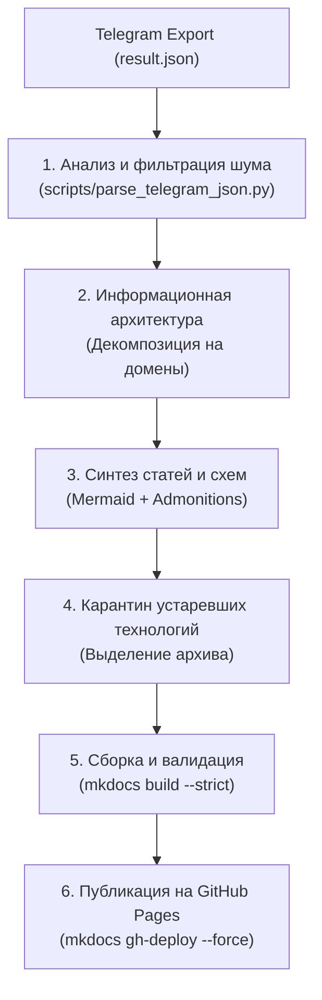

# Telegram Chat to Wiki Generator

This skill guides the end-to-end process of turning a raw, noisy Telegram Desktop export (`result.json`) into a clean, searchable, beautifully styled community Wiki powered by **Material for MkDocs** and published to **GitHub Pages**.

---

## Workflow Overview



---

## Step 1. Triage and Extract Technical Signal from `result.json`

Telegram chats contain 80–90% conversational noise, jokes, and duplicates. Do not write wiki pages directly from raw chat logs.

1. **Run the extraction helper:**
   Use the bundled script [`parse_telegram_json.py`](./scripts/parse_telegram_json.py):
   ```bash
   python3 .agents/skills/telegram-chat-to-wiki/scripts/parse_telegram_json.py result.json -o chat_summary.md --min-len 40
   ```
2. **Apply thematic filtering:**
   Extract key topics by keyword clusters (e.g. `antennas`, `batteries`, `frequencies`, `reconfiguring`, `firmware`).
3. **Follow the Curation Rules:**
   Consult [`references/curation-rules.md`](./references/curation-rules.md) for criteria on what constitutes actionable engineering data vs opinions.

---

## Step 2. Establish Information Architecture

Do not dump information into one giant monolithic page. Organize content into a clear multi-tiered tree:

```text
wiki/
├── index.md                              # Главная страница + дата актуальности
├── hardware/                             # Железо, чипсеты, антенны, питание, боксы
├── network/                              # Частотный план, профили LoRa, репитеры, Scopes, MQTT
├── firmware-and-software/                # Микроядро, прошивальщики, клиентские приложения
├── topology-and-geography/               # Высоты региона, кластеры городов, рекорды связи
├── guides-and-faq/                       # Быстрый старт, Troubleshooting, правовые нормы
└── <legacy-tech-archive>/                # Выделенный архив устаревшего стека (например, meshtastic/)
```

### Protocol Migration & Technology Quarantine:
If the community transitioned between protocols (e.g. from Meshtastic to MeshCore):
- **Never mix legacy terms into active setup guides**: Remove legacy concepts like `CLIENT_MUTE` or default 250 kHz bandwidth from current setup pages.
- **Move deprecated knowledge into a dedicated section**: Create a top-level section (e.g. `wiki/meshtastic/`) covering the historical background, comparison tables, and rollback instructions.

---

## Step 3. Initialize MkDocs Project with Material Theme

1. **Initialize wiki assets:**
   Run the initialization script [`init_mkdocs_wiki.sh`](./scripts/init_mkdocs_wiki.sh):
   ```bash
   bash .agents/skills/telegram-chat-to-wiki/scripts/init_mkdocs_wiki.sh wiki "My Community Wiki"
   ```
2. **Setup `mkdocs.yml`:**
   Use the reference configuration in [`references/mkdocs-template.md`](./references/mkdocs-template.md).
   Key configuration essentials:
   - Modern typography: `font.text: Inter`, `font.code: JetBrains Mono`.
   - Extensions: `admonition`, `pymdownx.details`, `pymdownx.superfences`, `tables`, `attr_list`.
   - Global footer copyright with relevance date: `copyright: "© 2026 Сообщество · Актуальность данных: ДД Месяц ГГГГ г."`.

---

## Step 4. Visual Diagrams and Interactive Pan & Zoom

- **Zero ASCII art**: Express all topologies, signal paths, state machines, and protocols using native Mermaid code blocks (`flowchart TD`, `graph LR`).
- **Interactive Pan & Zoom**: For complex regional topologies or flowcharts, standard responsive SVGs become unreadably small. Integrate local `svg-pan-zoom` and `mermaid.js` controllers (`+`, `−`, `↺ Reset`) following [`references/pan-zoom-setup.md`](./references/pan-zoom-setup.md).
- **Vendor scripts locally**: Always save `mermaid.min.js` and `svg-pan-zoom.min.js` inside `wiki/javascripts/` to guarantee offline reliability and fast rendering.

---

## Step 5. Styling and Content Guidelines

1. **Admonitions over raw code blocks:**
   Replace raw text warnings with Material callouts (`!!! important`, `!!! tip`, `!!! warning`, `!!! danger`).
2. **Eliminate unnecessary code fences:**
   Avoid ```` ``` ```` code blocks where bold text, tables, or inline `code` spans read cleaner.
3. **Traceability and Dates:**
   - Place a prominent date badge in `wiki/index.md` header:
     `> 📅 **Дата актуальности информации:** 23 октября 2026 г. | **Статус:** Активный регламент`
   - Include date in `copyright` in `mkdocs.yml` so it appears on every page footer.

---

## Step 6. Build, Validation, and Deployment

1. **Strict Build Validation:**
   Catch broken internal links, anchor errors, and missing files before committing:
   ```bash
   mkdocs build --strict
   ```
2. **Git Commit & Push:**
   Commit all markdown files and assets to `main`:
   ```bash
   git add mkdocs.yml wiki/ .gitignore
   git commit -m "Update wiki documentation"
   git push origin main
   ```
3. **Deploy to GitHub Pages:**
   Deploy directly using `ghp-import` integrated into mkdocs:
   ```bash
   git fetch origin
   mkdocs gh-deploy --force
   ```
   Verify that the deployed site is live at `https://<username>.github.io/<repo>/`.
