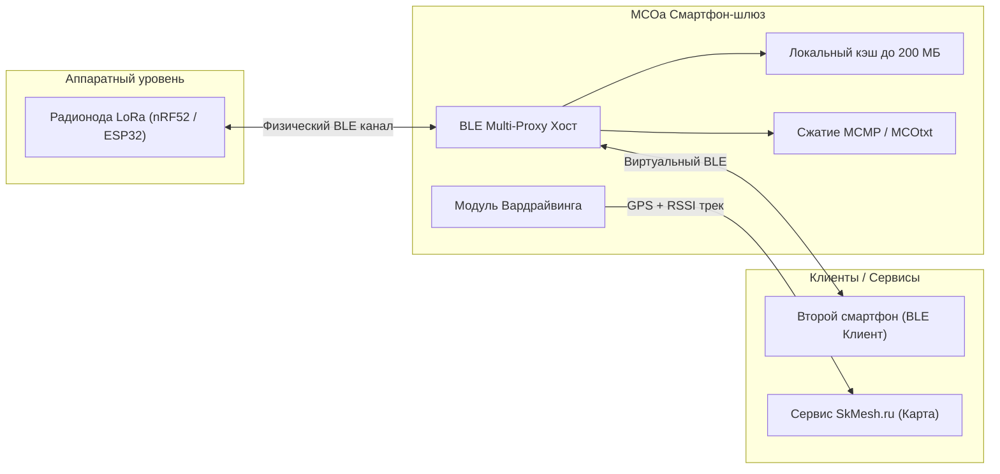

# Клиентский софт и программная экосистема (MCOa, Meshtastic, Reticulum)

Для комфортного взаимодействия с децентрализованной сетью радиомодемов используются мобильные и десктопные клиентские приложения, связывающиеся с нодами по Bluetooth Low Energy (BLE), Wi-Fi или USB-Serial. В сообществе СКФО сформировалась развитая программная инфраструктура.

---

## 1. Флагманский клиент: MeshCore Open Advanced (MCOa)

Стандартом де-факто для участников региональной сети стало мобильное приложение **MeshCore Open Advanced (MCOa)** (форк под авторством Антона Уральского и HDDen, активные релизы веток `9.5.1-mod` – `1.11.x`).



### Ключевые возможности MCOa:
1. **BLE Proxy (Multi-Connect):**
   - Устраняет аппаратное ограничение радиомодулей: большинство микроконтроллеров nRF52/ESP32 могут держать физическое соединение по Bluetooth только с одним смартфоном.
   - Телефон с запущенным MCOa подключается к ноде по физическому BLE и выступает шлюзом (прокси), позволяя другим смартфонам семьи или группы подключаться к нему по виртуальному BLE-мосту и пользоваться одной общей рацией.
2. **Продвинутое сжатие и медиаданные (MCMP / MCOtxt / MCOimg):**
   - Внедрен легковесный алгоритм компрессии текста **MCMP**, уменьшающий длину длинных сообщений в радиопакете до 40%.
   - Поддержка плейсхолдеров изображений `MCOimg` и анимаций GIF со встроенным кэшированием до 200 МБ на диске смартфона (предотвращает повторную выкачку медиа через медленный эфир).
3. **Встроенный модуль Wardrive (Вардрайвинг):**
   - Приложение использует GPS смартфона и RSSI/SNR принятых пакетов LoRa для построения карты реального радиопокрытия.
   - **Интеграция с [skmesh.ru](https://skmesh.ru):** Ввод персонального API-токена, настройка интервала сканирования (10 с для поездок на авто/велосипеде, 20–30 с для пеших прогулок). Данные автоматически загружаются на сервер и формируют тепловую карту покрытия края.

---

## 2. Официальные мобильные приложения и десктопные клиенты

### 2.1. Платформа Android
- **Meshtastic Android App:** Доступно в Google Play, F-Droid и репозитории GitHub. Используется для управления нодами Meshtastic, настройки каналов и экспорта логов.
- **MeshCore Android Client:** Нативное приложение для прямого взаимодействия с протоколом MeshCore и RoomServer.

### 2.2. Платформа iOS (Apple iPhone / iPad)
- Приложение **Meshtastic** доступно в официальном App Store.
- *Региональная специфика:* В случае временных региональных ограничений на скачивание в РФ-регионе учетной записи рекомендуется временное переключение региона Apple ID или установка через TestFlight.

### 2.3. Тактическое картографирование: Интеграция с ATAK (CivTAK)
- Смартфоны на Android под управлением **CivTAK** (Civilian Team Awareness Kit) подключаются к радиомодемам через плагин **Meshtastic ATAK Forwarder**.
- Обеспечивает обмен гео-метками, зонами внимания и маркерами объектов на топографических картах в условиях полного отсутствия интернета и сотовой связи.

---

## 3. Альтернативный криптографический стек: Reticulum (RNode)

Группа радиоинженеров и энтузиастов сообщества (*Доктор Z* и др.) ведет исследовательские работы и практическое тестирование альтернативного независимого криптографического стека **Reticulum Network Stack**:

```text
[ Плата Heltec V4 ] <== Прошивка RNode ==> [ Мобильное приложение Sideband / MeshChatX ]
                                                          |
                                           [ Автономный крипто-мессенджер ]
```

### Компоненты экосистемы Reticulum:
1. **Прошивка RNode / RTNode:**
   - Превращает типовые платы LoRa (Heltec V3/V4, T-Beam) в универсальные аппаратные радиомодемы для стека Reticulum.
   - Работает на уровне сырых кадров канального интерфейса с адаптивной скоростью передачи.
2. **Приложение Sideband:**
   - Полнофункциональный мобильный и десктопный интерфейс для связи через сеть Reticulum.
   - Поддерживает сквозное асимметричное шифрование сообщений, передачу файлов и голосовых заметок.
3. **Клиент MeshChatX:**
   - Легковесный чат-клиент, оптимизированный под медленные пакетные LoRa-радиоканалы высокой задержки.
4. **Стационарные интернет-шлюзы:**
   - Возможность бесшовного объединения нескольких радиоостровов через глобальный Reticulum-оверлей поверх интернета (I2P, Tor, TCP).
