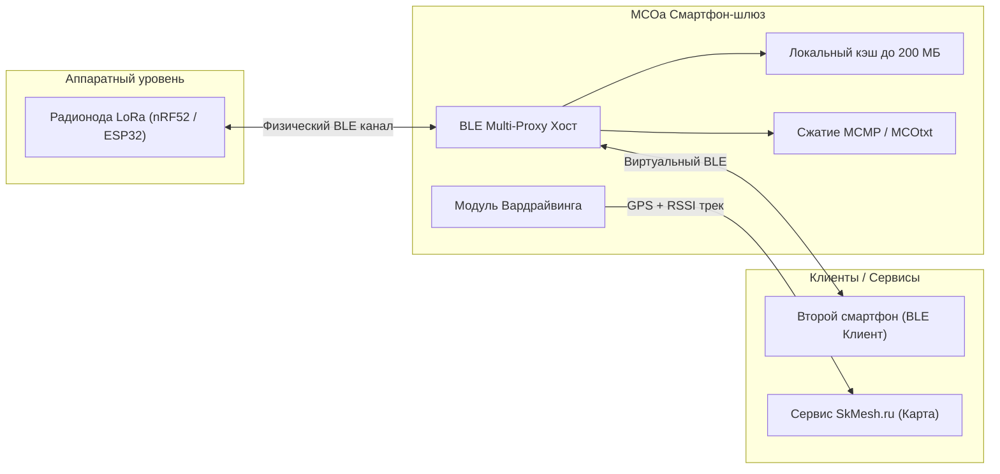
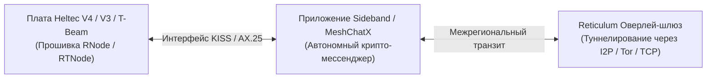

# Клиентский софт и программная экосистема MeshCore (MCOa, MeshCore App, Reticulum)

Для комфортного взаимодействия с децентрализованной сетью радиомодемов MeshCore используются мобильные, веб- и десктопные клиентские приложения, связывающиеся с нодами по Bluetooth Low Energy (BLE), Wi-Fi или USB-Serial. В сообществе СКФО сформировалась развитая программная инфраструктура.

---

## 1. Флагманский клиент: MeshCore Open Advanced (MCOa)

Стандартом де-факто для участников региональной сети стало мобильное приложение **MeshCore Open Advanced (MCOa)** (форк под авторством Антона Уральского и HDDen, активные релизы веток `9.5.1-mod` – `1.11.x`).

### Ключевые возможности MCOa:
1. **BLE Proxy (Multi-Connect):**
   - Устраняет аппаратное ограничение радиомодулей: большинство микроконтроллеров nRF52/ESP32 могут держать физическое соединение по Bluetooth только с одним смартфоном.
   - Телефон с запущенным MCOa подключается к ноде по физическому BLE и выступает шлюзом (прокси), позволяя другим смартфонам семьи или группы подключаться к нему по виртуальному BLE-мосту и пользоваться одной общей рацией.
2. **Продвинутое сжатие и медиаданные (MCMP / MCOtxt / MCOimg):**
   - Внедрен легковесный алгоритм компрессии текста **MCMP**, уменьшающий длину длинных сообщений в радиопакете до 40%.
   - Поддержка плейсхолдеров изображений `MCOimg` и анимаций GIF со встроенным кэшированием до 200 МБ на диске смартфона (предотвращает повторную выкачку медиа через медленный эфир).
3. **Встроенный модуль Wardrive (Вардрайвинг):**
   - Приложение использует GPS смартфона и RSSI/SNR принятых пакетов LoRa для построения карты реального радиопокрытия.
   - **Интеграция с [skmesh.ru](https://skmesh.ru):** Ввод персонального API-токена, настройка интервала сканирования (10 с для поездок на авто/велосипеде, 20–30 с для пеших прогулок). Данные автоматически загружаются на сервер и формируют тепловую карту покрытия края.

---

## 2. Мобильные клиенты MeshCore и веб-интерфейсы

### 2.1. Платформа Android: MeshCore Android Client
- Нативное клиентское приложение для прямого взаимодействия с протоколом MeshCore.
- Поддержка подключения к узлам по BLE и USB-OTG.
- Полная интеграция с сервисом **RoomServer (BBS)**: автоматическая синхронизация пропущенных сообщений при появлении в радиусе слышимости сервера, поддержка публичных каналов и приватных зашифрованных комнат.
- Встроенный монитор качества радиолинии (LQI, SNR, RSSI).

### 2.2. Платформа iOS: MeshCore Mobile Client
- Клиент для iPhone / iPad с поддержкой протокола MeshCore по Bluetooth Low Energy.
- Позволяет вести текстовый диалог через радиоканал 868.900 МГц без подключения к интернету и сотовой сети.

### 2.3. Веб-интерфейсы (Web Bluetooth / Web Serial)
- Региональный веб-клиент **[skmesh.ru](https://skmesh.ru)** и портал **[meshcoretel.ru](https://meshcoretel.ru)**: прямое подключение к подключенной по USB или BLE ноде прямо из браузера Chrome / Edge / Yandex.
- Глобальный веб-интерфейс **[web.meshcore.co.uk](https://web.meshcore.co.uk)**: оперативная отправка сообщений, просмотр топологии сети, карты нод и статусов ретрансляторов без установки сторонних программ.

### 2.4. Тактическая навигация и картография
- Сообщество использует интеграцию радиомодемов со связным комплексом **CivTAK** (Civilian Team Awareness Kit) для обмена координатами, геометками и маркерами зон в походах и поисковых операциях при полном отсутствии сотовой связи.

!!! note "Клиенты Meshtastic"
    Информация о классических клиентах Meshtastic для Android и iOS, а также плагине Meshtastic ATAK Forwarder вынесена в архивный раздел: [Прошивка и клиентский софт Meshtastic](../meshtastic/firmware-and-apps.md).

---

## 3. Альтернативный криптографический стек: Reticulum (RNode)

Группа радиоинженеров и энтузиастов сообщества (*Доктор Z* и др.) ведет исследовательские работы и практическое тестирование альтернативного независимого криптографического стека **Reticulum Network Stack**:

### Компоненты экосистемы Reticulum:
1. **Прошивка RNode / RTNode:**
   - Превращает типовые платы LoRa (Heltec V3/V4, T-Beam) в универсальные аппаратные радиомодемы для стека Reticulum.
   - Работает на уровне сырых кадров канального интерфейса с адаптивной скоростью передачи.
2. **Приложение Sideband:**
   - Полнофункциональный мобильный и десктопный интерфейс для связи через сеть Reticulum.
   - Поддерживает сквозное асимметричное шифрование сообщений, передачу файлов и голосовых заметок.
3. **Клиент MeshChatX:**
   - Легковесный чат-клиент, оптимизированный под медленные пакетные LoRa-радиоканалы высокой задержки.
4. **Стационарные интернет-шлюзы:**
   - Возможность бесшовного объединения нескольких радиоостровов через глобальный Reticulum-оверлей поверх интернета (I2P, Tor, TCP).
