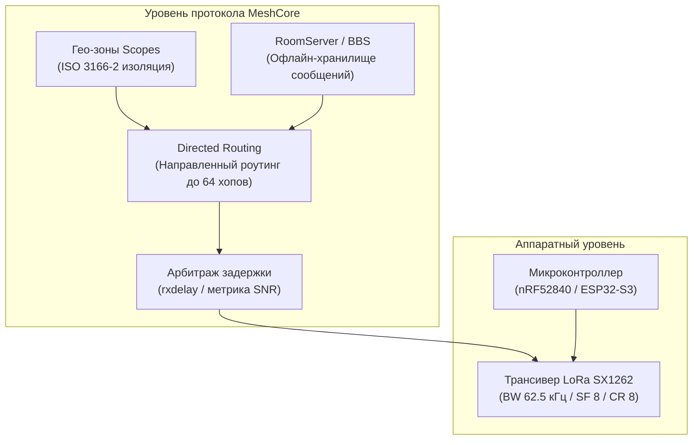
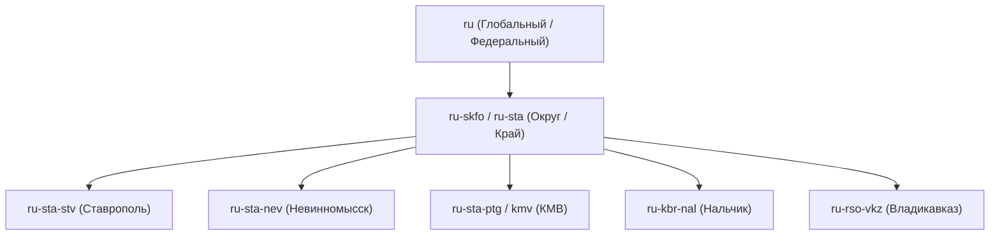

# Архитектура и протокол микроядра MeshCore

Микроядро **MeshCore** — это современная децентрализованная операционная система и протокол связи для ячеистых сетей LoRa. В 2026 году радиосообщество Ставропольского края и Северо-Кавказского федерального округа (СКФО) полностью перевело свою инфраструктуру на MeshCore как на единый региональный стандарт.

---

## 1. Ключевые архитектурные принципы

MeshCore разработан с нуля для решения фундаментальных проблем масштабирования радиосетей в условиях ограниченной полосы пропускания и сложного географического рельефа.

### 1.1. Направленная маршрутизация (Directed Routing)
В отличие от сетей с неуправляемым лавинным флудом, где каждый принятый пакет слепо ретранслируется всеми соседними узлами, MeshCore использует алгоритм **Directed Routing**:
- Узлы динамически строят и поддерживают внутреннюю таблицу топологии радиосети.
- Адресное сообщение отправляется строго по известной цепочке промежуточных транзитных станций.
- Лимит транзитных узлов составляет **до 64 хопов** (вместо жесткого ограничения в 7 хопов в устаревших протоколах). Это дает возможность связывать удаленные горные долины и равнины через цепочки солнечных ретрансляторов.

### 1.2. Арбитраж лучшего пути (`rxdelay`)
Когда несколько высотных ретрансляторов одновременно слышат один и тот же пакет, включается механизм оценки качества сигнала:
- Репитер с наилучшими показателями SNR и RSSI назначает себе минимальную задержку выхода в эфир (`rxdelay`) и производит ретрансляцию первым.
- Соседние станции, зафиксировав успешную передачу пакета лучшим узлом, мгновенно отменяют свои дублирующие очереди передачи. В результате радиоэфир освобождается более чем на 70%.

---

## 2. Изоляция трафика: Гео-зоны (Scopes)

Одной из важнейших особенностей MeshCore является поддержка иерархических идентификаторов областей видимости — **Scopes** (на базе международного стандарта ISO 3166-2).

- Высотные магистральные ретрансляторы настраиваются директивой `denyf *`, запрещающей трансляцию безадресного локального трафика за пределы населенного пункта.
- Разрешается прохождение только пакетов с явным префиксом регионального или межгородского назначения (`allowf ru-skfo`, `allowf ru-sta`).
- Это гарантирует, что локальная переписка в Ставрополе не блокирует эфир в Пятигорске или Нальчике.

---

## 3. Автономные станции сообщений: RoomServer (BBS)

В ячеистых сетях абонентские радиостанции регулярно выключаются, перемещаются в зоны тени или разряжаются. В MeshCore проблема доставки сообщений временно отсутствующим абонентам решена через архитектуру **RoomServer**:

1. **Сервер очередей (BBS):**
   - Узел с постоянным питанием и расширенной памятью (например, на высотном репитере или узле с Wi-Fi) регистрирует почтовую службу RoomServer.
2. **Асинхронная доставка:**
   - Сообщения, адресованные в тематические комнаты или конкретным пользователям, накапливаются в локальной базе сервера.
   - Как только абонентская нода появляется в радиоэфире и регистрируется, клиентское приложение автоматически запрашивает новые сообщения с сервера.
3. **Безопасность:**
   - Поддерживаются как открытые общественные доски объявлений, так и сквозное шифрование приватных сообщений.

---

## 4. Аппаратная универсальность и открытая лицензия MIT

- **Энергоэффективность:** Микроядро MeshCore оптимизировано для работы на маломощных чипсетах Nordic nRF52840 (ток сна 1–3 мА) и экономичных сборках ESP32 с пониженной частотой процессора (40–80 МГц).
- **Кросс-бенд мосты:** Ядро поддерживает штатное объединение двух LoRa-модемов по UART/I2C шине для прозрачной ретрансляции между несовпадающими частотными сетками (например, 868.900 МГц СКФО и 869.075 МГц КРД).
- **Лицензия MIT:** В отличие от тяжелых монолитных систем с лицензией GPLv3, MeshCore распространяется под разрешительной лицензией MIT, что обеспечивает максимальную гибкость интеграции с внешними микроконтроллерами, операционными системами и пользовательскими скриптами.

!!! info "История перехода"
    С подробным сравнительным анализом протоколов Meshtastic и MeshCore, а также предпосылками исторической миграции 2026 года можно ознакомиться в [разделе архива Meshtastic](../meshtastic/meshtastic-vs-meshcore.md).
