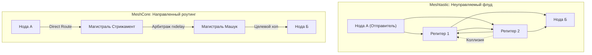

# Сравнение протоколов: Meshtastic vs MeshCore

Весной 2026 года радиосообщество Ставропольского края и СКФО совершило масштабный инфраструктурный переход: базовым протоколом региональной сети вместо Meshtastic стало микроядро **MeshCore**. Данный документ подробно анализирует предпосылки, фундаментальные архитектурные различия и практические результаты миграции.

---

## 1. Предпосылки миграции весной 2026 года

На начальном этапе (2024–2025 гг.) сеть разворачивалась на платформе **Meshtastic**. Однако по мере роста количества активных участников свыше 30–40 узлов в пределах агломерации сеть столкнулась с системным кризисом:

1. **Лавинообразный эфирный шторм (Controlled Flooding):** В Meshtastic каждый узел при получении пакета стремится ретранслировать его дальше. При появлении в городе десятков портативок и автомобильных трекеров эфир оказался забит на 90–95% служебными дублирующими пакетами. Доставка реальных сообщений упала ниже 30%.
2. **Проблема мобильных роутеров:** Новички хаотично активировали режим `ROUTER` на носимых устройствах, находясь внутри бетонных зданий и машин, что фрагментировало маршрутизацию и «ломало» связи с магистральными точками.
3. **Лимит 7 хопов (Hop Limit):** Архитектура Meshtastic принципиально ограничивает путь пакета максимум 7 транзитными пересылками (на практике из-за затуханий и коллизий предел составлял 3–4 хопа). Это сделало невозможным сквозной охват региона по цепочке «Ставрополь — Невинномысск — Минводы — Пятигорск — Нальчик — Владикавказ».
4. **Неуправляемость трафика:** Отсутствие механизма гео-зон (Scopes) приводило к тому, что локальные бытовые сообщения передавались высотными точками на сотни километров, создавая бессмысленную нагрузку на удаленные сегменты.

---

## 2. Сравнительная архитектурная таблица

| Критерий | Meshtastic | MeshCore |
| :--- | :--- | :--- |
| **Базовая модель маршрутизации** | **Controlled Flooding** («Орущее облако»). Пакет лавинообразно дублируется всеми нодами в радиусе слышимости. | **Directed Routing** (Управляемая топология). Пакет идет по запомненным цепочкам нод с динамической перестройкой маршрута. |
| **Максимальное число хопов** | Строго до **7 хопов** (TTL 7). | До **64 хопов**. Позволяет охватывать целые федеральные округа через цепочки ретрансляторов. |
| **Помехозащищенность эфира** | Низкая при масштабировании. При росте нод сеть самоблокируется коллизиями. | Высокая. Узлы ретранслируют только адресный трафик и используют арбитраж лучшего пути (`rxdelay`). |
| **Офлайн-сообщения и хранение** | Ограниченный модуль Store & Forward (требует выделенных нод, частые сбои). | Полноценный механизм **RoomServer / BBS** с приватными и публичными комнатами, асинхронной синхронизацией. |
| **Подтверждения доставки (ACK)** | Слабые широковещательные ACK. Часто теряются в коллизиях, вызывая ложные повторные отправки. | Сквозные криптографические ACK с контролем хеша пути. |
| **Изоляция трафика (Scopes)** | Отсутствует. Трафик делится только PSK-ключами закрытых каналов. | Встроенная поддержка **Scopes (ISO 3166-2)** и фильтрация флуда (`denyf *`). |
| **Двухмодемные мосты** | Не поддерживаются штатно. | Нативная поддержка мостов между разночастотными модемами по UART/I2C. |
| **Лицензия исходного кода** | **GPLv3** (жесткий копилефт, сложность интеграции в кастомные ОС). | **MIT** (свободная, легковесная разрешительная лицензия). |

---

## 3. Ключевые технологические преимущества MeshCore

### 3.1. Умная маршрутизация до 64 хопов
MeshCore хранит динамическую таблицу топологии. При отправке прямого сообщения пакет направляется точно по известному вектору. Промежуточные узлы не генерируют вторичный всенаправленный флуд, что освобождает радиоэфир для других пользователей. Лимит в 64 хопа позволяет связывать даже горные труднодоступные ущелья Кавказа через цепочки солнечных маломощных ретрансляторов.

### 3.2. Архитектура RoomServer (BBS)
В классическом Meshtastic, если адресат находился вне сети в момент отправки сообщения, оно безвозвратно терялось. 
В MeshCore внедрены автономные почтовые станции — **RoomServer**:

- Узел на господствующей высоте или сервере сообщества накапливает сообщения для пользователей и тематических комнат.
- При включении носимой рации клиентское приложение автоматически опрашивает RoomServer и подтягивает пропущенную переписку за последние дни.
- Поддерживаются как публичные доски объявлений, так и зашифрованные персональные ящики.

---

## 4. Итоги перехода для региона

Переход на MeshCore весной 2026 года позволил:

1. Полностью ликвидировать паразитные радиоштормы в Ставрополе и Невинномысске.
2. Объединить разрозненные городские радиосети в общую устойчивую магистраль СКФО.
3. Обеспечить мгновенную доставку экстренных и связных сообщений при сохранении легальной мощности передатчиков в 25 мВт.
