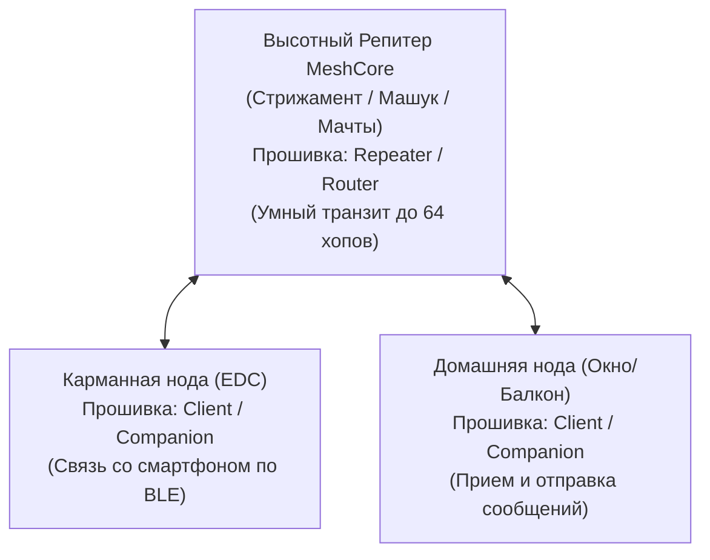

# Руководство по быстрому старту (Quick Start Guide)

Добро пожаловать в радиосообщество Meshcore СКФО! Это пошаговое руководство поможет новичку выбрать правильное "железо", прошить его актуальным ПО, настроить регламентные радиопараметры Северо-Кавказского региона и отправить свое первое сообщение в эфир.

---

## 1. Выбор первой платы

Перед покупкой важно определить, как именно будет использоваться устройство: дома у окна или в кармане на улице.

| Платформа / Модель | Чипсет / Архитектура | Автономность | Назначение и вердикт |
| :--- | :--- | :--- | :--- |
| **Heltec LoRa 32 v3 / WSL v3** | ESP32-S3 + SX1262 | Низкая (12–18 ч от 18650) | **Идеально для дома.** Встроенный Wi-Fi позволяет сделать домашний шлюз к веб-карте. Требует постоянного питания от 220V/USB. |
| **Heltec MeshNode T114** | nRF52840 + SX1262 | Высокая (3–7 суток) | **Идеально для кармана и походов.** Ультранизкое энергопотребление чипа Nordic, встроенный контроллер солнечной батареи, BLE. |
| **DarkTec / FakeTec V5** | nRF52840 + HT-RA62 | Экстремальная | **Продвинутый DIY.** Доступные самодельные платы под 3D-печать для автономных ретрансляторов и карманных нод. |
| **SenseCAP T1000-E** | nRF52840 + SX1262 | Высокая (2–4 суток) | **Готовое фабричное решение.** Герметичный корпус IP65, встроенный GPS, зуммер и кнопка SOS в формате банковской карты. |

!!! danger
    **ПРАВИЛО №1 В РАДИОСВЯЗИ:** Категорически запрещено включать плату (подавать питание по USB или от аккумулятора) **без подключенной антенны**! Без антенны выходной каскад усилителя мощности (PA) чипа SX1262 мгновенно сгорает из-за 100% отражения энергии обратно в микросхему.

---

## 2. Подключение и прошивка

Для быстрой и надежной прошивки рекомендуется использовать региональный веб-флешер через браузеры Chrome или Edge (с поддержкой Web Serial API):

1. **Подготовка:**
    - Подключите плату к компьютеру качественным кабелем USB Type-C (убедитесь, что кабель поддерживает передачу данных, а не только зарядку).
    - Прикрутите штатную антенну к разъему SMA или подсоедините пигтейл IPX.
2. **Прошивка:**
    - Перейдите в веб-прошивальщик сообщества: **`https://skmesh.ru/ru/flasher`** (или официальный web-flasher **`flasher.meshcore.co.uk`**).
    - Выберите вашу модель платы (например, *Heltec V3* или *Heltec T114*).
    - Нажмите кнопку **Flash / Install**, выберите COM-порт устройства и дождитесь завершения процедуры стирания и записи памяти.

---

## 3. Первичная настройка радиоканала СКФО

В радиосети СКФО принят единый стандарт частот и модуляции. Если ваши параметры отличаются хотя бы на одну цифру, вы не услышите никого в эфире.

### Регламентные параметры радиоканала СКФО:

- **Частота:** `868.900 МГц`
- **Полоса (Bandwidth / BW):** `62.5 кГц`
- **Коэффициент расширения спектра (Spreading Factor / SF):** `8`
- **Коррекция ошибок (Coding Rate / CR):** `8` (4/8)

### Настройка через консоль (Serial CLI)
Подключитесь к ноде через терминал (115200 бод) или интерфейс SkMesh/MCOA и примените команды:

```text
set radio 868.900, 62.5, 8, 8
set cad on
set tx 11
reboot
```

!!! note
    Значение `set tx 11` (или до 14 dBm) соответствует выходной мощности до 25 мВт, что обеспечивает полное соблюдение законодательства РФ и сохраняет заряд аккумулятора.

---

## 4. Назначение устройства: Клиент (Companion) vs Репитер (Repeater)

В отличие от устаревшего протокола Meshtastic, где каждому пользователю приходилось вручную выставлять роли вроде `CLIENT_MUTE` для подавления лавинного флуда, в **MeshCore** архитектура изначально разделена на уровне типов узлов и прошивок:



1. **Клиентский узел (Client / Companion) — для 95% пользователей:**
    - Стандартный выбор для личных плат, подключаемых к смартфону по Bluetooth (BLE) или USB.
    - Узел принимает и отправляет личные и групповые сообщения, синхронизируется с RoomServer.
    - Благодаря алгоритму **Directed Routing** клиентская нода не засоряет эфир слепой ретрансляцией чужого мусора и не требует принудительного программного «заглушения» ретрансляции.
2. **Ретранслятор (Repeater / Router) — только для опорных высот:**
    - Специальная сборка прошивки для автономных стационарных мачт с круговым обзором (гора Стрижамент, гора Бештау, вышки связи).
    - Оснащается тонким арбитражем задержек (`rxdelay`, `direct.txdelay`), контролем петель (`loop.detect strict`) и фильтрацией гео-зон (`denyf *`).
    - *Обычным пользователям не требуется устанавливать режим репитера дома или в кармане — для полноценной связи достаточно клиентской прошивки.*

---

## 5. Первое тестовое сообщение и проверка эхо-бота

1. Установите мобильное приложение:
    - **MCOa (MeshCore Open Advanced)** — рекомендованный форк для Android с поддержкой BLE Proxy и сжатия;
    - либо нативный мобильный клиент **MeshCore** (Android / iOS), либо веб-интерфейс **skmesh.ru**.
2. Включите Bluetooth на телефоне и выполните сопряжение с вашей платой.
3. Откройте региональный канал / область видимости (например, скоуп `ru-skfo`, `ru-sta-stv` или общий публичный чат).
4. Отправьте тестовое сообщение в чат, например: `Тест из Юго-Западного района (Ставрополь), прием?`
5. **Проверка через Эхо-бота / Инфо-ноду:**
    - Отправьте личное сообщение (Direct Message) на адрес городского эхо-бота (или локального ретранслятора, поддерживающего команду `ping`).
    - Получение ответа с показателями RSSI (уровень сигнала в дБм) и SNR (отношение сигнал/шум) подтвердит, что ваш приемопередающий тракт и антенна полностью исправны.
