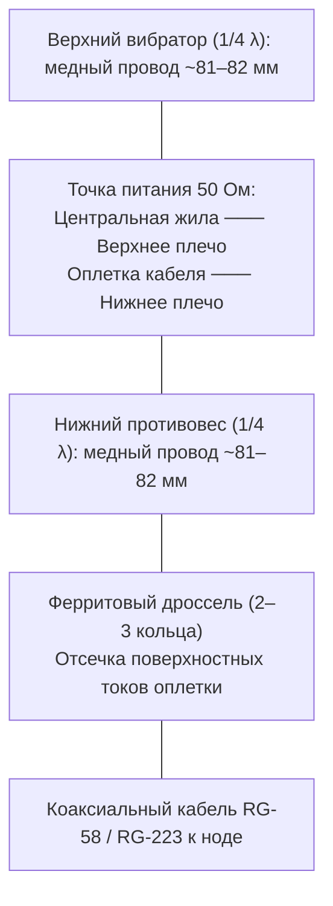
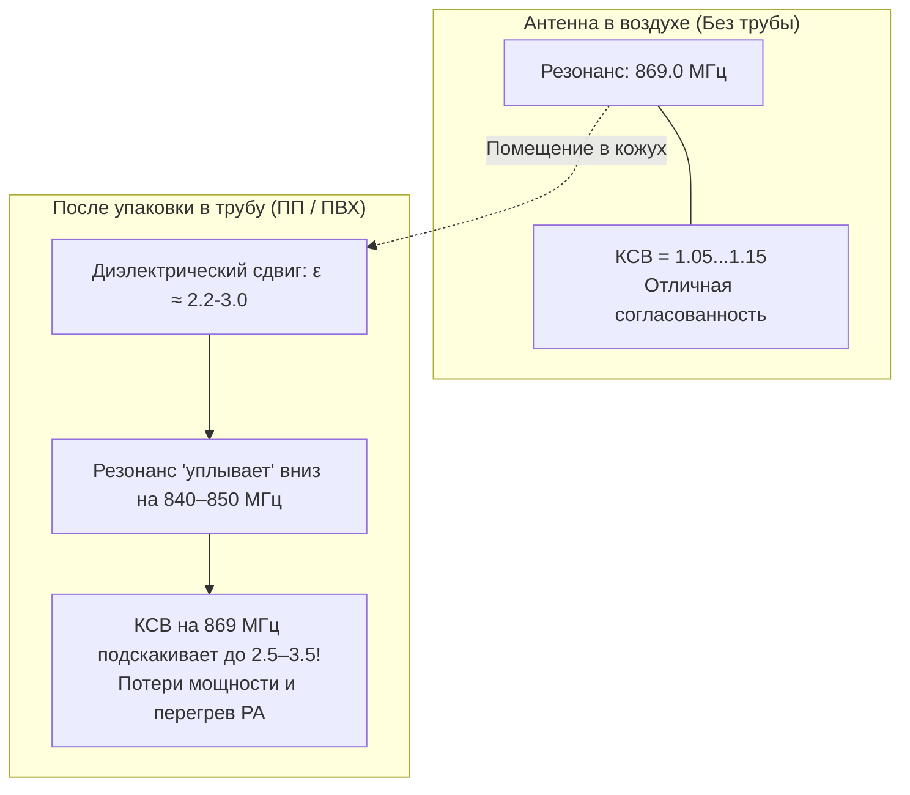

# Антенны, фидеры и ВЧ-часть сети Meshcore СКФО

Качество радиосвязи в диапазоне 868 МГц на 80% зависит от антенно-фидерного тракта. В условиях холмистого ландшафта Ставропольской возвышенности и предгорий Кавказа даже перестановка антенны на 2 метра выше или замена дешевого кабеля на качественный дает больший выигрыш в дальности (до +20…30 дБ), чем увеличение мощности передатчика в десять раз.

---

## 1. Инструментальный контроль: Опыт измерений с NanoVNA

Все антенны перед подъемом на мачту или установкой на портативную ноду **в обязательном порядке** проверяются векторным анализатором цепей (NanoVNA).

### Главные правила калибровки:

1. **Калибровка с пигтейлом (Reference Plane):** Калибровку прибора (Open-Short-Load) необходимо делать на том разъеме (SMA), куда будет подключаться антенна, то есть **вместе с кабелем-переходником (пигтейлом IPX/U.FL -> SMA)**. На частоте 868 МГц емкость и индуктивность самого пигтейла длиной всего 10–15 см способны сместить частоту резонанса на 15–30 МГц.
2. **Влияние рук и окружения:** Измерение параметров антенны нельзя проводить, держа её в руках или положив на металлический стол. Антенна должна быть удалена от металлических предметов минимум на 1–1.5 метра (например, закреплена на диэлектрической штанге).

### Реальные результаты тестов фабричных антенн:

* **Стоковые «резинки» Heltec («хлыстики» 5–7 см):**
    - Реальный резонанс большинства комплектных антенн из посылок с AliExpress находится в диапазоне **915–925 МГц** (стандарт США).
    - На рабочей частоте СКФО (869 МГц) их **КСВ (SWR) часто превышает 2.5–3.8**.
    - Излучение уходит в нагрев выходного каскада платы. Включение ноды без качественной антенны может сжечь чип SX1262.
* **Антенны Gizont 868 (хлысты 16–20 см):**
    - Имеют встроенный латунный согласующий стакан.
    - Показывают честный КСВ от 1.15 до 1.3 на частоте 868.8 МГц.
    - *Предостережение:* Ни в коем случае нельзя укорачивать или разбирать эти антенны «по советам из интернета» — это уничтожает согласование.
* **Baltic Signal (Отечественные штыри и коллинеары):**
    - Качественные герметичные корпуса, честный КСВ 1.1–1.2 на 868 МГц, высокий коэффициент усиления (от 5 до 8 dBi). Отличный выбор для стационарных мачт.

---

## 2. Конструкции самодельных антенн

Для повторения радиолюбителями сообщества отработаны 4 проверенных типа антенн:

### 2.1. Вертикальный полуволновой диполь (1/2 λ)
Самая простая, надежная и повторяемая конструкция.

* **Конструктив:**
    - Изготавливается из качественного коаксиального кабеля (RG-58, RG-223) или двух отрезков медного одножильного провода сечением 1.5–2.5 мм².
    - Длина каждого плеча (вибратора) рассчитывается по формуле:
    $$L = \frac{c}{4 \cdot f} \cdot k = \frac{300}{4 \cdot 869} \cdot 0.95 \approx 82 \text{ мм}$$

    - Одно плечо припаивается к центральной жиле, второе — к оплетке кабеля (направлено вниз).
* **Симметрирование:** Чтобы оплетка фидера не излучала и не искажала диаграмму направленности, сразу под точкой запитки устанавливается **U-колено** либо надеваются **2–3 ферритовые защелки (ферритовые кольца)**.
* **Усиление:** ~2.15 dBi.
* **Диаграмма:** Круговая (всенаправленная в горизонтальной плоскости).

### 2.2. J-антенна («Джейка») и модификация «Psi Emitter»
Антенна с параллельным согласующим шлейфом (J-Pole). Фаворит сообщества Ставрополя для высотных узлов.

* **Плюсы конструкции:**
    - Замкнута по постоянному току (автоматически защищает вход приемника от накопления статического электричества перед грозой).
    - Не требует противовесов (радиалов), имеет прижатый к горизонту угол излучения (идеально для покрытия предгорий).
* **Конструктив модели «Psi Emitter» (разработка Constantine, повторенная в Ставрополе и Невинномысске):**
    - Рассчитана и оптимизирована в Ansys HFSS специально под диэлектрическую проницаемость трубы.
    - Полотно из биметаллической или медной проволоки диаметром 1.8–2.0 мм.
    - Согласующий шлейф 1/4 λ и излучатель 1/2 λ.
    - Узел `PSI Emitter@sta_stv` на этой антенне обеспечивает уверенный линк на десятки километров сквозь весь город.

### 2.3. Четвертьволновый штырь Ground Plane (1/4 λ)

* Штырь длиной ~80 мм, установленный на приборный разъем SMA или N-type.
* 3–4 наклонных противовеса под углом 135° к вертикали обеспечивают входное сопротивление, близкое к 50 Ом.
* Отличное решение для компактной установки на крышу металлического шкафа (шкаф служит экраном/противовесом).

### 2.4. Направленные антенны: Moxon и Волновой канал (Яги)
Применяются для дальних магистральных пролетов (линк Ставрополь — Невинномысск — Минводы).

* **Антенна Моксона (Moxon 868 МГц):**
    - Двухэлементная прямоугольная антенна из изогнутого провода.
    - Усиление ~5.5–6.0 dBi при отличном подавлении заднего лепестка (F/B ratio > 20 dB).
    - Компактный размер (~12×16 см), низкая парусность. Легко изготавливается на пластиковом каркасе, напечатанном на 3D-принтере.
* **Волновой канал (Yagi-Uda на 5–7 элементов):**
    - Узкий луч с усилением 9–11 dBi.
    - Позволяет пробивать перевалы, работать на отражениях от горных массивов (Стрижамент, Недреманная) и связывать удаленные населенные пункты.

---

## 3. Влияние защитных кожухов на резонансную частоту

Для защиты от дождя и птиц самодельные антенны уличного размещения упаковывают в водопроводные пластиковые трубы.

> [!WARNING]
> **Эффект укорочения в диэлектрике:**
> Любой пластиковый кожух имеет диэлектрическую проницаемость $\varepsilon_r > 1$ (у полипропилена ПП $\varepsilon_r \approx 2.2$, у ПВХ $\varepsilon_r \approx 3.0$). При помещении полотна антенны внутрь трубы **резонансная частота неминуемо смещается вниз на 15–35 МГц!**

### Правильная технология изготовления в трубе:

1. Рассчитайте и изготовьте полотно с запасом по частоте вверх (настраивайте в воздухе на **885–895 МГц**).
2. Поместите антенну внутрь целевой трубы с заглушками.
3. Проведите контрольный замер NanoVNA через пигтейл. Подрезайте излучатель по 1–2 мм до тех пор, пока минимум КСВ внутри собранной трубы не встанет ровно на **868.8–869.2 МГц**.
4. **Материал труб:** Полипропиленовые водопроводные трубы (серые/белые) имеют меньшие диэлектрические потери на СВЧ, чем дешевые серые канализационные трубы из серого ПВХ (в составе ПВХ часто присутствует технический углерод, дающий паразитное затухание).

---

## 4. Кабельное хозяйство (Фидеры), пигтейлы и фильтры

### 4.1. Сравнение коаксиальных кабелей на частоте 868 МГц (затухание на 10 метров)

| Марка кабеля | Внешний диаметр | Затухание на 10м (@868 МГц) | Применение и рекомендации |
| :--- | :--- | :--- | :--- |
| **RG-178** (пигтейлы) | 1.8 мм | **~15.0 дБ** | Только короткие переходы (не более 10–15 см)! |
| **RG-58** (дешевый) | 5.0 мм | **~5.2 дБ** | Не рекомендуется на длинах более 2–3 метров |
| **RG-223 / RG-400** | 5.4 мм | **~4.1 дБ** | Двойная посеребренная оплетка, стойкий к изгибам |
| **LMR-200 / 5D-FB** | 5.0–7.5 мм | **~2.8 дБ** | Отличный кабель для фидеров 5–8 метров |
| **LMR-400 / 8D-FB** | 10.3 мм | **~1.3 дБ** | Профессиональный фидер для высоких мачт (>10 метров) |

*Вывод:* На частоте 868 МГц использование 5 метров кабеля RG-58 «съест» более половины мощности передатчика! Для репитера идеальная компоновка — размещение ноды в гермобоксе прямо на мачте под антенной с минимальным пигтейлом (10 см RG-178 / RG-316).

### 4.2. Врезка SAW-фильтров (Фильтры на ПАВ)
На высотных точках (крыши высоток, вышки РТРС, район Макарова в Ставрополе, гора Машук в Пятигорске) эфир перегружен внеполосными помехами от передатчиков GSM-900, LTE и цифрового ТВ.

* Приемник SX1262 перегружается мощной помехой, и чувствительность катастрофически падает.
* **Решение:** Установка узкополосного полосового фильтра на поверхностных акустических волнах (SAW Bandpass Filter 868 MHz) с полосой пропускания ~2–4 МГц.
* Фильтр врезается в разрыв между антенным разъемом и входом радиомодуля. Затухание в полосе составляет всего ~1.5–2 дБ, но подавление помех сотовой связи на 900 МГц достигает **35–45 дБ**.

### 4.3. Защита от статического электричества (ESD)

* На длинных мачтах перед грозой накапливается колоссальный статический потенциал от ветра и сухого воздуха.
* Рекомендуется использовать антенны замкнутого типа (J-антенны, петлевые вибраторы) либо устанавливать газоразрядные грозоразрядники (Lightning Protector 50 Ohm) с подключением к заземляющему контуру мачты проводом сечением не менее 6 мм².
