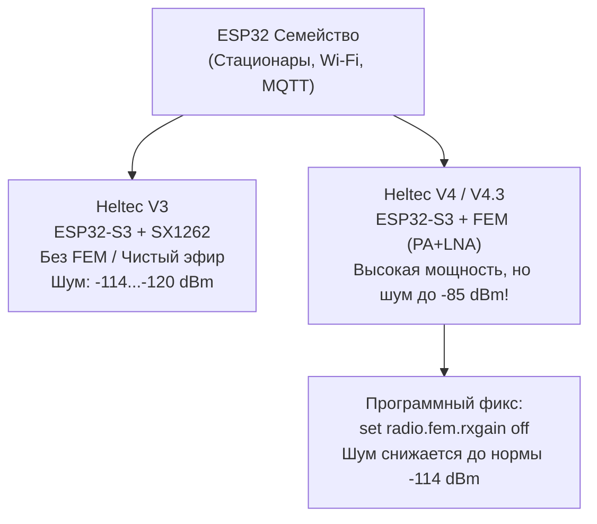
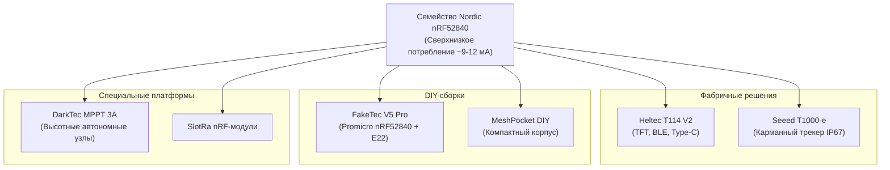
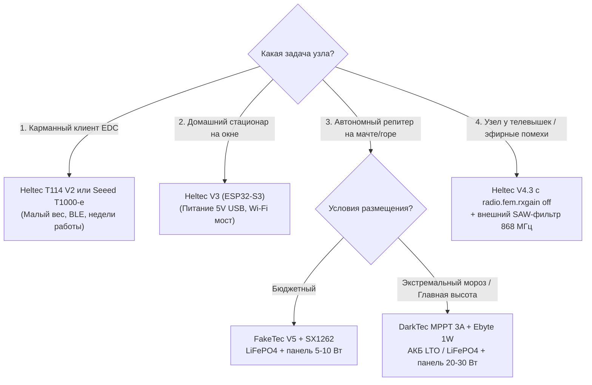

# Сравнение аппаратных платформ и чипов Meshcore СКФО

В условиях сложного рельефа Северо-Кавказского федерального округа (перепады высот от равнин Ставрополья до отрогов Кавказского хребта, балки, ущелья и городские застройки) правильный выбор аппаратной базы является критическим фактором живучести узла. 

В сообществе сформировались две базовые концепции построения сети:

1. **Энергоэффективная распределенная автономная сеть (nRF52840):** базовые уличные репитеры на мачтах, питающиеся от небольших солнечных батарей, а также карманные компаньоны.
2. **Мощные стационары, шлюзы и узлы наблюдения (ESP32):** домашние ноды с постоянным питанием, Wi-Fi/MQTT-брокерами, телеметрией и веб-интерфейсом.

---

## 1. Архитектурное сравнение микроконтроллеров: ESP32 vs nRF52840

| Параметр | Семейство ESP32 (ESP32-D0WD, S3) | Семейство Nordic nRF52840 |
| :--- | :--- | :--- |
| **Ядро и архитектура** | Xtensa Dual-Core 32-bit (до 240 МГц) | ARM Cortex-M4F 32-bit с FPU (64 МГц) |
| **Ток в режиме приема (RX)** | ~100 – 150 мА (высокое базовое потребление SoC) | ~6 – 12 мА (в режиме радиоприема SX1262) |
| **Ток в режиме глубокого сна (Deep Sleep)** | ~10 – 50 мкА (без радио) | ~2 – 5 мкА (с активным RTC и таймерами) |
| **Автономность от 1× 18650 (2500 мА·ч)** | 18–36 часов (в режиме Eco-репитера до 10–12 суток) | **2–4 недели** (карманный узел), до **30–45 суток** (репитер) |
| **Беспроводные интерфейсы** | Wi-Fi 802.11 b/g/n + Bluetooth 4.2 / 5 (BLE) | Bluetooth 5.0 Long Range (BLE), NFC, Thread/Zigbee |
| **Сетевые функции** | Web-сервер, Wi-Fi станция, MQTT-клиент, TCP/IP шлюз | Работает как компактный Bluetooth-компаньон / чистый LoRa-ретранслятор |
| **Основное назначение в СКФО** | Домашние базовые станции, узлы-наблюдатели, MQTT-мосты | Мачтовые репитеры, горные автономки, карманные трекеры |

---

## 2. Линейка плат на базе ESP32



### Heltec WiFi LoRa 32 V3 (ESP32-S3 + SX1262)
Классическая народная плата первого поколения перехода на SX1262.

- **Плюсы:**
    - Встроенный OLED-дисплей 0.96", разъем Type-C, развитое комьюнити.
    - Низкий уровень собственного радиошума (-114...-120 дБм).
    - Наличие Wi-Fi позволяет запустить веб-интерфейс Meshcore и транслировать телеметрию в локальный MQTT.
- **Минусы:**
    - Высокое энергопотребление: в активном приеме потребляет 110–130 мА. На морозе от одной банки 18650 не живет дольше суток.
    - Повышенный нагрев контроллера заряда при подключении внешнего источника 5В.
- **Применение в СКФО:** Домашний оконный шлюз, балконный узел наблюдения с Wi-Fi подключением к роутеру.

### Heltec WiFi LoRa 32 V4 / V4.2 / V4.3 (ESP32-S3 + SX1262 + Внешний FEM/LNA/PA)
Плата с интегрированным радиочастотным модулем Front-End Module (FEM), включающим предварительный усилитель мощности (PA) и малошумящий усилитель на приеме (LNA).

- **Проблема шумов и «глухоты»:** 
  Из-за чрезмерного аппаратного усиления LNA собственный уровень шума на входе приемника подскакивает до **-85...-89 дБм** (вместо нормальных -114...-120 дБм). В условиях города плата оказывается «глухой» — она способна передавать сигнал на десятки километров, но не слышит слабые пакеты от портативок.

- **Программное лечение через CLI Meshcore:**
  Для отключения внешнего LNA и возврата чувствительности применяется команда:
  ```text
  set radio.fem.rxgain off
  ```
  Это снижает шумовую полку до **-114 дБм**.
  Также рекомендуется снижать избыточное усиление трансивера:
  ```text
  set tx -1
  ```
  (ограничение выходной мощности до разрешенных 25 мВт с учетом коэффициента усиления внешнего PA каскада).

- **Особенности v4.3:**
  В ревизии v4.3 производитель предусмотрел контактные площадки под установку внешнего полосового SAW-фильтра на 868 МГц, что делает её отличным «комбайном» для установки вблизи телевышек и сотовых вышек (РТПЦ, Машук, Макаров).

### LilyGO T-Beam (ESP32 / ESP32-S3 + SX1262 + GPS NEO-6M/M8N + AXP192/AXP2101)

- **Плюсы:** Интегрированный отсек под 1× 18650, продвинутый контроллер питания AXP (аппаратный мониторинг тока, напряжений), встроенный GPS.
- **Минусы:** Крупные габариты, существенное потребление энергии встроенным GPS-модулем (дополнительно 40–60 мА при постоянном локе спутников).
- **Применение в СКФО:** Автомобильные ноды-трекеры, базовые станции мобильных поисковых групп в горах.

### LilyGO Wireless Paper (ESP32-S3 + SX1262 + E-Paper 2.13")

- **Плюсы:** Сверхнизкое энергопотребление дисплея (E-Ink потребляет ток только в момент перерисовки экрана), отличная читаемость на прямом горном солнце.
- **Минусы:** Медленное обновление экрана, хрупкость дисплея при падении.

### Модули Heltec HT-CT62 (ESP32-C3 + SX1262)
Компактный SMD-модуль на базе одноядерного RISC-V ESP32-C3. Используется самодельщиками для миниатюрных трекеров, однако проигрывает чипам nRF52 по энергоэффективности.

---

## 3. Линейка плат на базе Nordic nRF52840



### Heltec T114 (nRF52840 + SX1262)
Флагман сообщества для компактных автономных узлов.

- **Характеристики:** Встроенный цветной TFT-дисплей (опционально отключаемый для экономии), разъем для подключения Li-Ion/LiFePO4, низкое токопотребление (~9–11 мА в дежурном приеме).
- **Специфика ревизии V2:** В T114 v2 исправлены утечки по шине питания и оптимизирована антенная цепь.
- **Автономность:** От одного элемента 18650 (2500 мА·ч) работает до 8–10 суток в режиме компаньона.

### Seeed Card Tracker T1000-e
Ультратонкий трекер в формате кредитной карты с защитой IP67. Включает датчики температуры, движения, GPS и беспроводную зарядку. Идеален для ношения в рюкзаке при выходах в горы КБР и КЧР.

### FakeTec V5 / Faketec Pro Micro

- Открытая народная DIY-плата на микроконтроллере Pro Micro nRF52840 и радиомодуле Heltec HT-RA62 (SX1262).
- **Прошивка и обновление (UF2 Bootloader):** Подключение по обычному кабелю Type-C в режиме накопителя. Двойной клик по кнопке Reset монтирует плату как флешку, куда просто копируется файл `.uf2`.
- **Специфика Bluetooth (BLE):**
  На прошивках Meshcore для nRF52 дальность устойчивой связи со смартфоном по BLE на открытом воздухе достигает 15–30 метров, но сквозь капитальные железобетонные стены снижается до 3–5 метров.

- **DFU OTAFIX (Защита от окирпичивания):**
  В полевых условиях при мачтовой установке критически важна функция обновления прошивки «по воздуху» (DFU OTA). При зависании или сбое прошивки специальный загрузчик OTAFIX позволяет восстановить работоспособность репитера без демонтажа мачты.

### Отечественная плата DarkTec (DarkElectronics, Краснодарский край / СКФО)
Разработка инженера Александра, созданная специально с учетом опыта эксплуатации репитеров на Кавказе:

- **Pin-to-pin совместимость** с платами FakeTec V5, но с кардинально усиленной аппаратной частью.
- **Солнечный контроллер:** Интегрированный MPPT-преобразователь с широким диапазоном входного напряжения **от 7 до 30 В** и током заряда **до 3 А** (позволяет подключать большие уличные панели 12В/24В мощностью 20–50 Вт).
- **Сетевой вход и USB-PD:** Поддержка стандартов Power Delivery (PD 2.0 / 3.0) и внешнего питания 5–28 В.
- **Мультихимический контроллер АКБ:** Аппаратная поддержка Li-Ion (4.2 В), LiFePO4 (3.65 В), LTO (2.8 В) и LiHV (4.35 В) с защитой от глубокого переразряда.
- **Чистота эфира:** Трехступенчатая CLC-фильтрация шины питания (шумы менее 10 мВ p-p), исключающая наводки на радиоприемник.
- **Поддержка супер-мощных модулей:** Разводка контактов позволяет устанавливать модули **Ebyte E22-900M30S** (1 Вт, 30 dBm) и **E22-900M33S** (2 Вт, 33 dBm) для построения сверхдальних магистральных линков.

---

## 4. Сравнительная таблица радиочастотных трансиверов

| Параметр | Semtech SX1276 / SX1278 | Semtech SX1262 | Semtech SX1268 | Ebyte E22-900M30S | Ebyte E22-900M33S |
| :--- | :--- | :--- | :--- | :--- | :--- |
| **Поколение** | Прошлое (LoRa Gen 1) | Современное (LoRa Gen 2) | Китайский аналог SX1262 | Модуль на SX1262 + PA | Модуль на SX1262 + PA |
| **Диапазон частот** | 137–1020 МГц (SX1276) | 150–960 МГц | 410–493 МГц (только 433) | 850–930 МГц (включая 868) | 850–930 МГц (включая 868) |
| **Макс. мощность (TX)** | +20 дБм (100 мВт) | **+22 дБм (160 мВт)** | +22 дБм | **+30 дБм (1000 мВт / 1 Вт)** | **+33 дБм (2000 мВт / 2 Вт)** |
| **Чувствительность (RX)** | до -137 дБм | до **-148 дБм** | до -148 дБм | до -148 дБм | до -148 дБм |
| **Ток в режиме RX** | ~11–13 мА | **~4.6–5.3 мА (DCDC)** | ~4.6–5.3 мА | ~18–25 мА (LNA каскад) | ~20–30 мА |
| **Ток в режиме TX** | ~120 мА (@20 дБм) | ~118 мА (@22 дБм) | ~118 мА | ~600–700 мА (@30 дБм) | ~1100–1400 мА (@33 дБм) |
| **Применение в СКФО** | Устаревшие T-Beam v1 | Стандарт сети СКФО 868 | Не рекомендуется (нет 868) | Магистральные репитеры | Высотные линки Кавказа |

!!! important
    **Рекомендация сообщества СКФО по выбору трансивера:**
    Всегда выбирайте узлы на базе **SX1262**. Трансиверы первого поколения (SX1276/SX1278) имеют худшую чувствительность (разница до 9–11 дБ, что в условиях горного рельефа снижает радиус устойчивой связи в 2–3 раза) и вдвое большее энергопотребление в режиме непрерывного приема. Чип **SX1268** аппаратно предназначен исключительно для диапазона 433–470 МГц и не может работать в стандарте СКФО (868.7–869.2 МГц).

---

## 5. Сводная матрица выбора оборудования под задачи


