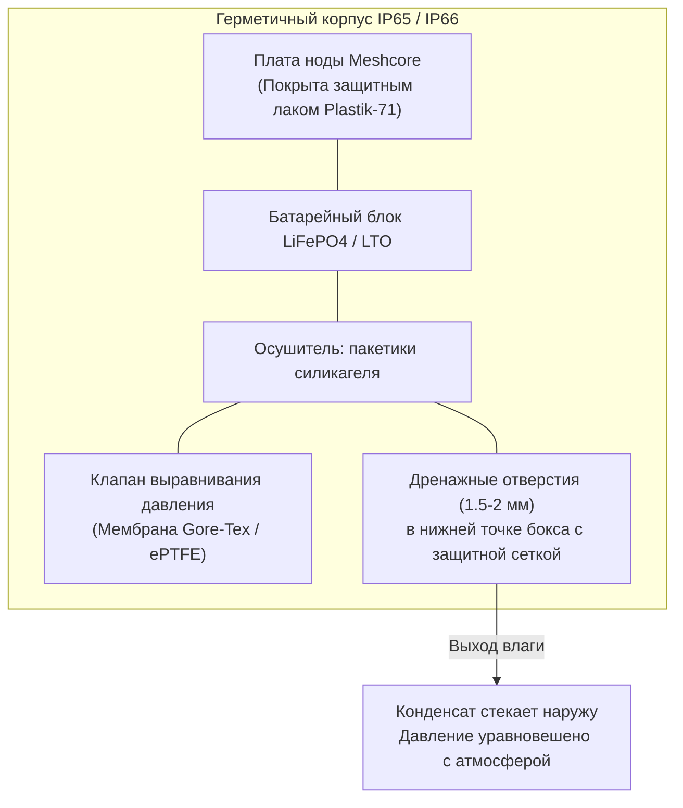
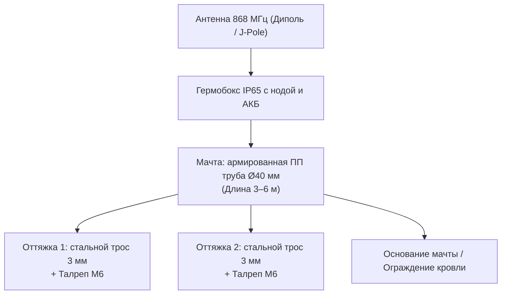

# Корпуса, термоусадка, мачты и уличный монтаж узлов Meshcore СКФО

Северный Кавказ характеризуется экстремальными ветровыми нагрузками (в Ставрополе регулярны шквальные ветра до 25–30 м/с), повышенной влажностью, обледенением мачт и интенсивным ультрафиолетовым излучением в горах. Некачественный монтаж или ошибка в выборе материалов приводят к выходу оборудования из строя в течение первых же месяцев.

---

## 1. Выбор боксов и борьба с конденсатом

### 1.1. Класс защиты: IP65 vs IP67 / IP68

* Для уличных репитеров идеален стандарт **IP65 – IP66** (защита от струй воды и пыли).
* Рекомендуются промышленные распределительные коробки из поликарбоната или ударопрочного ABS с уплотнительным силиконовым шнуром по периметру (серии Hensel, DKC, Spelsberg или качественный китайский IEK/Эра).

### 1.2. Опасность «наглухо герметичного» бокса
Самая частая ошибка новичков — залить все швы силиконовым герметиком и закупорить бокс.

* **Физика процесса:** Днем на солнце воздух внутри бокса нагревается до +50°C и расширяется. Ночью при резком похолодании воздух сжимается, создавая вакуум, который засасывает влажный уличный воздух через микропоры сальников и резьбу разъемов.
* При падении температуры ниже точки росы влага конденсируется на радиомодуле и выводах ESP32/nRF52, образуя лужицы дистиллированной воды, вызывающие электрохимическую коррозию и замыкания.

### 1.3. Грамотная вентиляция и дренаж:

1. **Дренажные отверстия:** В самой нижней точке днища бокса сверлятся 2–3 отверстия диаметром 2–3 мм. Снаружи они закрываются мелкоячеистой металлической сеткой от насекомых (или ватным тампоном). Это позволяет стекать любой случайно скопившейся влаге.
2. **Дышащие мембраны (Gore-Tex клапаны):** Использование резьбовых компенсационных клапанов давления (например, M12 с мембраной ePTFE / Gore-Tex). Мембрана свободно пропускает молекулы воздуха и пара, выравнивая внутреннее давление с атмосферным, но полностью блокирует воду в жидкой фазе.
3. **Силикагель:** Внутрь бокса обязательно укладывается мешочек с прокаленным силикагелем (50–100 г) для поглощения стартовой остаточной влажности воздуха при монтаже.

---

## 2. Материалы для 3D-печати корпусов и креплений

При изготовлении самодельных кронштейнов, фиксаторов антенн и портативных корпусов на 3D-принтере выбор филамента критичен:

| Материал | Стойкость к УФ | Термостойкость | Прочность / Ударная вязкость | Пригодность для улицы в СКФО |
| :--- | :--- | :--- | :--- | :--- |
| **PLA** | Очень низкая (деградирует за 2–3 месяца) | Плывет уже при **+55°C** (на солнце потечет!) | Хрупкий на морозе | **КАТЕГОРИЧЕСКИ ЗАПРЕЩЕН** |
| **PETG** | **Высокая** (не боится солнца) | Держит до **+70°C...+75°C** | Высокая межслойная адгезия | **РЕКОМЕНДОВАН** (народный выбор) |
| **ABS** | Средняя (желтеет и становится хрупким) | Держит до **+90°C** | Прочный, но усадка при печати | Допустим при покраске от УФ |
| **ASA** | **Превосходная** (максимальная защита от УФ)| Держит до **+95°C** | Высочайшая ударопрочность | **ИДЕАЛЕН** (профессиональный выбор)|

> [!TIP]
> **Цвет филамента имеет значение:**
> Для уличных корпусов и кронштейнов используйте только **белый, светло-серый филамент или пластик цвета хаки**. Черные корпуса на южном солнце СКФО нагреваются свыше +75°C, что приводит к размягчению пластика и перегреву электроники.

---

## 3. Компактная герметизация: Термоусадочная трубка

Для ультралегких нод (например, FakeTec V5 или Heltec T114 без дисплея), поднимаемых на легких удочках или подвешиваемых на деревьях:

* Применяется толстостенная клеевая термоусадочная трубка диаметром **25–26 мм** (с коэффициентом усадки 3:1 или 4:1).
* **Технология сборки:**
    1. Плата покрывается защитным акриловым или силиконовым лаком (типа Plastik-71) в 2–3 слоя с промежуточной сушкой (разъемы SMA и USB перед лакировкой заклеиваются малярным скотчем).
    2. Плата помещается в термоусадку. С торцов термоусадки термоклеем фиксируются кабель антенны и провод питания/аккумулятор.
    3. Прогрев строительным феном с температурой 120–140°C. Выдавленный по краям внутренний термоплавкий клей создает монолитный герметичный кокон, устойчивый к вибрациям и воде.

---

## 4. Мачты и уличный монтаж в условиях ветров СКФО

В Ставрополе («городе ветров») и на открытых вершинах (Стрижамент, Машук, Недреманная) ветровые нагрузки являются главной причиной аварий.

### 4.1. Конструкция легких мачт из полипропиленовых (ПП) труб

* Обычные тонкостенные серые трубы канализации на ветру ломаются или изгибаются дугой.
* **Стандарт сообщества:** Использование **полипропиленовых водопроводных труб диаметром 32–40 мм, армированных стекловолокном или алюминием** (PPR-FB-PPR / PPR-AL-PPR).
* Такие трубы обладают высокой жесткостью, не ржавеют, не экранируют радиосигнал (диэлектрик) и легко сращиваются стандартными муфтами под пайку на высоту до 4–6 метров.

### 4.2. Система оттяжек (растяжек)

* Мачта высотой более 2.5 метров в климате СКФО **обязательно должна иметь минимум один ярус оттяжек (3 или 4 луча под углом 120° или 90°)**.
* **Материалы растяжек:**
    - Оцинкованный стальной трос в ПВХ-оплетке диаметром **2–3 мм**;
    - Либо синтетический шнур из дайнемы / полиэфирный плетеный шнур с защитой от УФ (не растягивается при намокании).
* **Фурнитура:** Крепление троса через коуши, зажимы типа «Dplex» и натяжные винтовые талрепы (крюк-кольцо М6) для сезонной регулировки натяжения.

### 4.3. Опасность оконного монтажа («подоконниковые репитеры»)
Сообщество СКФО крайне не рекомендует устанавливать ноды внутри комнат на подоконниках:

* Современные металлопластиковые стеклопакеты оснащаются энергосберегающим напылением (i-стекло / серебряное напыление). Такое стекло работает как зеркало для СВЧ радиоволн, ослабляя сигнал на **15–25 дБ (в 30–300 раз!)**.
* Железобетонные панели домов собирают весь спектр радиопомех от импульсных блоков питания, зарядников смартфонов и роутеров соседей.
* **Правило:** Выносите антенну минимум на 1–1.5 метра за пределы фасада/балкона на выносном диэлектрическом или металлическом кронштейне.
