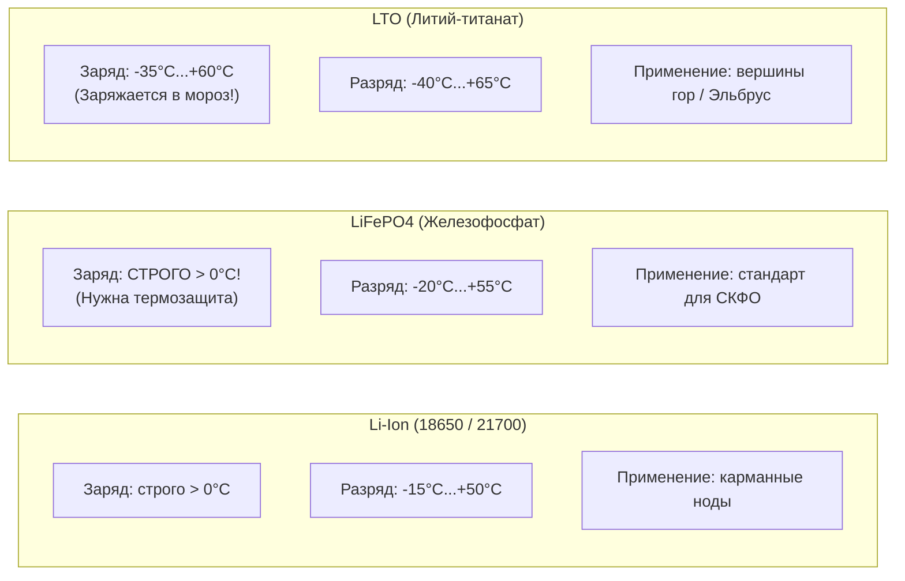
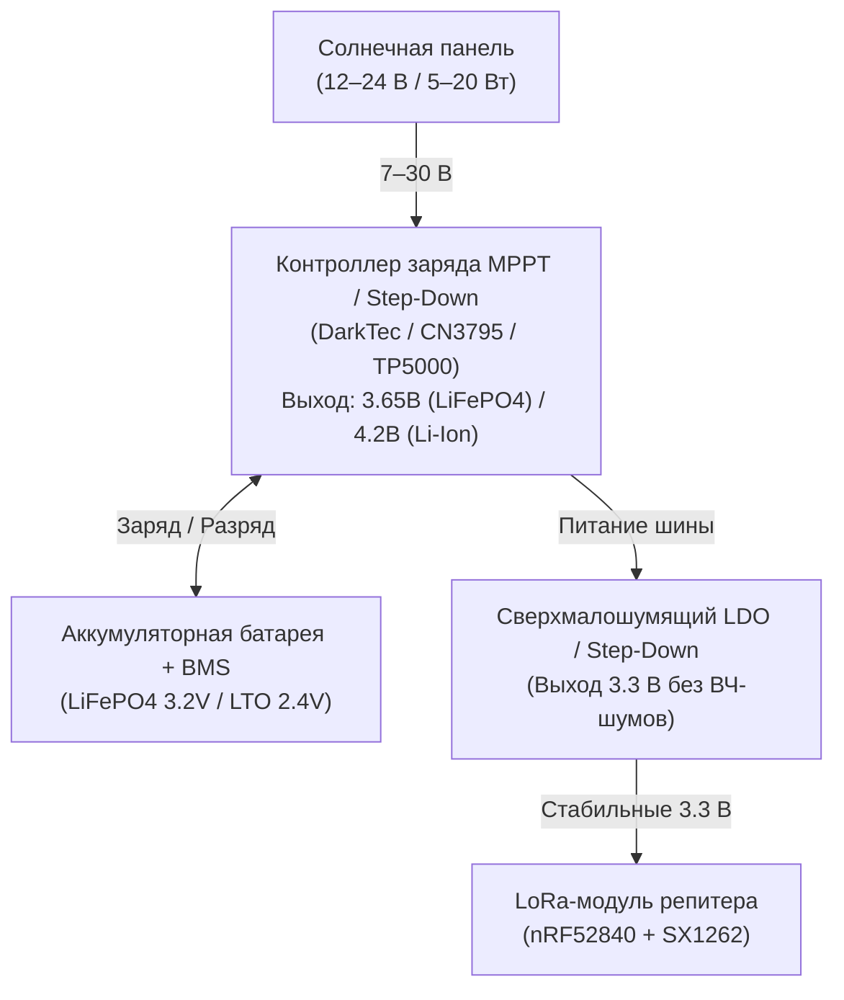
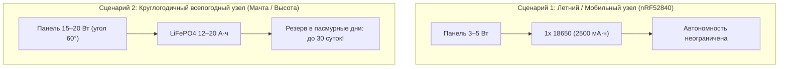

# Питание и автономность репитеров в условиях СКФО

Климат Северного Кавказа предъявляет жесткие требования к автономным системам: летом температура на открытом солнце в степной части Ставрополья превышает +45°C (внутри гермобокса до +65°C), а зимой на возвышенностях и перевалах опускается до -25°C...-35°C при штормовых ветрах и затяжной пасмурной погоде (до 2–3 недель без прямого солнца).

---

## 1. Сравнение электрохимических систем аккумуляторов



| Параметр | Li-Ion (NMC/NCR 18650/21700) | LiFePO4 (Литий-железо-фосфат) | LTO (Литий-титанат) |
| :--- | :--- | :--- | :--- |
| **Номинальное напряжение** | 3.7 В | 3.2 В | 2.3–2.4 В |
| **Напряжение полного заряда** | **4.20 В** | **3.65 В** | **2.80 В** |
| **Напряжение отсечки (разряд)**| 2.80–3.00 В | 2.50 В | 1.60 В |
| **Ресурс циклов (до 80%)** | 300–500 циклов | **2000–4000 циклов** | **15 000–25 000 циклов** |
| **Заряд при отрицательных T°** | **Запрещен** (выделение металлического лития, риск КЗ) | **Категорически запрещен ниже 0°C** (деградация за 5–10 циклов) | **РАЗРЕШЕН до -30°C...-35°C!** |
| **Пожаробезопасность** | Средняя (риск терморазгона при перегреве) | **Абсолютная** (не горит при пробое и перезаряде) | **Абсолютная** |
| **Стоимость/доступность** | Дешево, повсеместно | Доступно, умеренная цена | Высокая цена, редкие элементы |
| **Применение в СКФО** | Домашние ноды, носимые компаньоны | **Стандарт для уличных круглогодичных репитеров** | **Экстремальные высокогорные ноды (Эльбрус, Домбай, перевалы)** |

> [!CAUTION]
> **Физика лития на морозе:**
> Зарядка Li-Ion и LiFePO4 при отрицательных температурах приводит к осаждению дендритов металлического лития на аноде. Это необратимо разрушает емкость батареи и гарантированно приводит к внутреннему микро-КЗ. Если ваш репитер на LiFePO4 эксплуатируется зимой, контроллер заряда **должен иметь термодатчик с защитой от заряда ниже 0°C**, либо батарея должна быть утеплена/закопана в грунт ниже точки промерзания.

---

## 2. Контроллеры заряда и микросхемы управления



### 2.1. Популярная плата TP4056 (Почему ее НЕЛЬЗЯ использовать для LiFePO4)

* **Аппаратное ограничение:** TP4056 заряжает аккумулятор строго по профилю CC/CV до напряжения **4.20 В (±1%)**.
* Если подключить к TP4056 элемент LiFePO4, напряжение превысит безопасный предел 3.65 В, что приведет к вскипанию электролита, срабатыванию предохранительного клапана и мгновенной гибели аккумулятора.
* Кроме того, TP4056 — линейный контроллер. При подключении панели с напряжением 12 В он рассеивает излишек напряжения в тепло (КПД менее 35%), раскаляясь до +80°C.

### 2.2. Модуль TP5000 (Универсальное бюджетное решение)

* Импульсный понижающий (Buck) контроллер заряда с поддержкой входного напряжения до 9 В.
* **Переключение химии:** На плате есть контактные площадки `F` (Fe).
    - Контакты разомкнуты: режим Li-Ion (отсечка 4.2 В).
    - **Контакты замкнуты каплей припоя: режим LiFePO4 (отсечка 3.65 В).**
* Высокий КПД (~88–92%), слабый нагрев, ток заряда до 1–1.5 А.

### 2.3. Профессиональный MPPT-контроллер DarkTec

* **Диапазон входа:** 7–30 Вольт (позволяет подключать любые стандартные уличные солнечные панели 12/24 В мощностью до 50 Вт).
* **Поиск точки максимальной мощности (MPPT):** В пасмурную погоду или при частичном затенении выжимает из панели на 25–40% больше энергии, чем ШИМ или линейные стабилизаторы.
* **Выходной ток:** До 3 Ампер.
* **Аппаратная мультихимия:** Переключение резистивными делителями под любые типы банок (Li-Ion, LiFePO4, LTO, LiHV).
* **Сверхчистое питание:** CLC-фильтры подавляют импульсные пульсации до уровня < 10 мВ, что сохраняет рекордную чувствительность трансивера SX1262 (-148 дБм).

### 2.4. Защита от глубокого разряда (Undervoltage Lockout)
Плата контроллера или обязательная плата BMS (Battery Management System) должна жестко отключать нагрузку:

- Для Li-Ion: при падении ниже **2.8 В**;
- Для LiFePO4: при падении ниже **2.5 В**.
Разряд ниже 2.0 В приводит к окислению медных токоотводов и необратимо превращает аккумулятор в «кирпич».

---

## 3. Расчет солнечных панелей и энергобаланса

Энергетический баланс узла строится на правиле: **среднесуточная выработка в самый темный месяц года (декабрь-январь) должна минимум в 1.5 раза превышать суточное потребление всей электроники**.

### 3.1. Энергопотребление оборудования в режиме репитера

| Платформа | Средний ток (дежурный прием) | Мощность при 3.7 В | Суточное потребление (Вт·ч) |
| :--- | :--- | :--- | :--- |
| **nRF52840 (Faketec / T114)** | ~9 мА | ~0.033 Вт | **~0.8 Вт·ч / сутки** |
| **ESP32-S3 (Heltec v3 / v4)** | ~110 мА | ~0.407 Вт | **~9.8 Вт·ч / сутки** |
| **ESP32 + GPS + OLED экран** | ~170 мА | ~0.629 Вт | **~15.1 Вт·ч / сутки** |

*Разница колоссальна:* Платформе на ESP32 требуется в **12 раз больше** энергии, чем ноде на nRF52840!

### 3.2. Расчет солнечной панели для условий СКФО



#### Сценарий А: Летний / Мобильный репитер (nRF52840)

- Летом в Ставрополе и на КМВ инсоляция составляет 5–6 пиковых часов в сутки.
- Панель **5 Вольт / 3–5 Вт** выдает ток 600–800 мА.
- За 2 часа ясного неба батарея 18650 восполняет суточный расход ноды. Достаточно 1 банки 18650 (2500 мА·ч).

#### Сценарий Б: Круглогодичный автономный мачтовый репитер (СКФО, Зима)

- Зимой в Ставрополе из-за частых туманов, гололеда и снега количество солнечных дней минимально (инсоляция < 1 пикового часа в сутки, рассеянный свет дает 5–10% от номинала панели).
- **Выбор солнечной панели:** Не менее **15–20 Вт** (напряжение 12–18 В). Даже в глухой пасмурный день панель 20 Вт через MPPT-контроллер выдаст 80–120 мА тока, чего с избытком хватит для покрытия нужд nRF52840.
- **Угол наклона панели:** Для СКФО на зиму панель ориентируют строго на юг под углом **60°–65° к горизонту**. Крутой угол предотвращает налипание мокрого снега и обеспечивает перпендикулярное падение лучей низкого зимнего солнца.
- **Емкость аккумулятора:** Сборка LiFePO4 емкостью **12–20 А·ч** (или 4 банки 32700). Запас энергии составляет ~40–65 Вт·ч, что гарантирует **более 40 суток непрерывной работы** репитера вообще без какого-либо притока от солнца.

---

## 4. Настройка телеметрии питания в прошивке Meshcore

Чтобы в мобильном приложении и сети корректно отображался процент остаточного заряда, необходимо указать тип используемой химии через консоль CLI:

```text
# Для стандартного литий-ионного аккумулятора 4.2 В:
set pwr.batt-type li-ion

# Для литий-железо-фосфатного аккумулятора LiFePO4 3.65 В:
set pwr.batt-type lifepo4

# Задать калибровочный делитель АЦП (если вольтметр врет):
set pwr.adc-multiplier 2.05
save
reboot
```

> [!TIP]
> Если физически подключен LiFePO4, а в настройках оставлен `li-ion`, нода уже при напряжении 3.3 В (где у LiFePO4 сосредоточено еще 70% емкости) будет ошибочно рапортовать в сеть о «критическом разряде 10%» и уходить в аварийный спящий режим.
