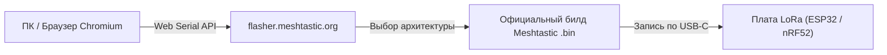

# Прошивка и клиентский софт Meshtastic

В данном руководстве задокументированы инструменты работы со стоковой прошивкой Meshtastic, мобильные приложения для смартфонов, плагин для тактической картографии ATAK и процедура стирания памяти при миграции.

---

## 1. Официальный веб-прошивальщик flasher.meshtastic.org

Для установки и обновления стоковой прошивки Meshtastic используется официальный инструмент проекта:

- **Адрес ресурса:** [flasher.meshtastic.org](https://flasher.meshtastic.org)
- **Требования:** Браузер с поддержкой Web Serial API (Chrome, Edge, Yandex Browser) на ПК или Android.



### Порядок прошивки:
1. Подключите плату к USB-порту компьютера;
2. Нажмите **Connect** и укажите COM-порт устройства;
3. Выберите модель оборудования (например, *Heltec v3*, *LilyGO T-Beam*, *Seeed Xiao*) и желаемую версию прошивки;
4. Для чистовой установки отметьте чекбокс **Full Erase and Install**.

---

## 2. Мобильные клиенты Meshtastic

Для работы со стоковыми нодами Meshtastic по интерфейсу Bluetooth Low Energy (BLE) разработаны нативные приложения:

### 2.1. Платформа Android
- **Источники загрузки:**
  - [Google Play Store: Meshtastic](https://play.google.com/store/apps/details?id=com.geeksville.mesh)
  - [F-Droid Репозиторий](https://f-droid.org)
  - Официальные APK в релизах репозитория [GitHub meshtastic/Meshtastic-Android](https://github.com/meshtastic/Meshtastic-Android/releases)
- **Функционал:**
  - Полноэкранный чат по публичным и приватным каналам;
  - Встроенная карта с отображением координат узлов и гео-треков;
  - Полный доступ к конфигурационным параметрам (роли, мощность, частоты, каналы);
  - Экспорт и импорт настроек через QR-коды.

### 2.2. Платформа Apple iOS (iPhone / iPad)
- **Источник:** Официальный [Apple App Store: Meshtastic](https://apps.apple.com/app/meshtastic/id1586432531).
- **Специфика:** В случае региональных ограничений на загрузку в РФ-сегменте App Store пользователи сообщества использовали регистрацию резервного Apple ID или установку бета-билдов через TestFlight.

---

## 3. Тактическое картографирование: Meshtastic ATAK Forwarder

Для автономной навигации поисково-спасательных отрядов и полевых радиоэкспедиций использовалась связка смартфонов с тактическим приложением **CivTAK** (Civilian Team Awareness Kit) и плагином **Meshtastic ATAK Forwarder**:

```mermaid
flowchart LR
    TAK["Приложение CivTAK (Android)<br/>(Тактическая топокарта)"]
    PLUGIN["Плагин Meshtastic Forwarder<br/>(Преобразование CoT в LoRa-пакеты)"]
    NODE["Плата LoRa (Bluetooth)<br/>(Передатчик 868 МГц)"]

    TAK <-->|API CoT (Cursor-on-Target)| PLUGIN
    PLUGIN <-->|BLE радиоканал| NODE
```

- Плагин транслирует метки объектов, треки движения и маркеры зон из интерфейса ATAK в короткие пакеты LoRa.
- **Внимание к эфиру:** Передача CoT-пакетов генерирует высокий радиочастотный трафик. При работе в общих сетях интервалы маяков ATAK обязательно увеличивались до 5–10 минут во избежание блокировки эфира.

---

## 4. Полная очистка памяти при переходе между Meshtastic и MeshCore

При смене операционной системы ноды (перепрошивка с Meshtastic на MeshCore или обратно при тестовом откате) структуры flash-памяти NVS (Non-Volatile Storage) и файловой системы LittleFS могут конфликтовать, вызывая циклические перезагрузки (Bootloop).

Перед заливкой новой системы **обязательно** выполните полное стирание памяти микроконтроллера через `esptool.py`:

```bash
# Для плат на базе ESP32 / ESP32-S3:
esptool.py --port /dev/ttyUSB0 erase_flash

# Для плат на Nordic nRF52840 (через J-Link):
nrfjprog -f nrf52 --recover
nrfjprog -f nrf52 --eraseall
```
После стирания плата готова к чистой установке прошивки [MeshCore](../firmware-and-software/flashing-guide.md).
