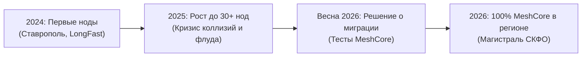

# Раздел Meshtastic: История сети и миграция на MeshCore

Данный раздел представляет собой историко-технический архив регионального радиосообщества Ставропольского края и Северо-Кавказского федерального округа (СКФО), посвященный этапу эксплуатации протокола **Meshtastic** (2024–2025 гг.) и последующему полному переходу на микроядро **MeshCore** весной 2026 года.

---

## 1. История зарождения сети на Meshtastic

В 2024–2025 годах энтузиасты Ставрополя, Невинномысска и КМВ начали развертывание первых цифровых узлов LoRa на открытом протоколе Meshtastic. Это позволило создать первоначальное ядро радиолюбительской сети, протестировать аппаратную базу (платы Heltec, LilyGO T-Beam, T-Echo) и проверить физическую возможность прохождения сигналов на дальние расстояния в условиях сложного рельефа Кавказа.

---

## 2. Причины системного кризиса Meshtastic в масштабах региона

По мере роста количества узлов (более 30–40 активных станций в городской агломерации и на высотах) классический протокол Meshtastic столкнулся с непреодолимыми архитектурными барьерами:

1. **Лавинообразный эфирный шторм (Controlled Flooding):**
   - Алгоритм лавинной маршрутизации приводил к тому, что каждый узел при получении пакета пытался ретранслировать его дальше во все стороны.
   - В условиях плотной городской застройки при одновременной работе нескольких десятков устройств эфир заполнялся эхо-повторами на 90–95%, а доставка реальных сообщений упала ниже 30%.
2. **Ограничение в 7 хопов (Hop Limit):**
   - Архитектурное ограничение TTL в 7 транзитных пересылок сделало невозможным построение сквозной цепочки ретрансляторов вдоль всего Северного Кавказа («Ставрополь — Стрижамент — Невинномысск — Минводы — Машук — Нальчик — Владикавказ»).
3. **Огромный Airtime на широкой полосе (BW 250 кГц / SF11):**
   - Стандартный пресет `LongFast` занимал эфир почти на 1 секунду на каждое короткое сообщение, многократно повышая вероятность коллизий.
4. **Отсутствие направленной маршрутизации и изоляции локаций (Scopes):**
   - Любая локальная болтовня в городском чате ретранслировалась высотными узлами (Стрижамент, Бештау) на 200–300 км, парализуя работу соседних городов.

---

## 3. Полный переход на MeshCore весной 2026 года

Весной 2026 года координаторы и технический совет сообщества СКФО приняли единогласное решение: **полностью перевести всю регулярную инфраструктуру региона на протокол MeshCore**.

Основные результаты миграции:

- **100% нод региона** (магистральные ретрансляторы, городские узлы, частные домашние станции и карманные носимые рации) работают на прошивках с микроядром MeshCore;
- Переход на регламентный профиль **868.900 МГц / BW 62.5 кГц / SF 8 / CR 8**;
- Внедрение управляемой маршрутизации (до **64 хопов**), гео-зон (Scopes по ISO 3166-2) и почтовых серверов RoomServer.

---

## 4. Навигация по архивному разделу Meshtastic

Для тех участников, которые проводят радиоэксперименты, настраивают кросс-протокольные шлюзы со сторонними регионами или восстанавливают старые устройства, сохранены подробные справочные материалы:

- **[Сравнение протоколов: Meshtastic vs MeshCore](meshtastic-vs-meshcore.md)** — глубокий архитектурный разбор различий между лавинным флудом и направленной маршрутизацией.
- **[Архивные частоты, пресеты и канал «Stavropol»](legacy-frequencies-and-channels.md)** — радиопараметры эпохи Meshtastic, Слот 2 (869.075 МГц), пресет LongFast и ключ AES-256 канала `Stavropol`.
- **[Конфигурация узлов и фильтрация CORE_PORTNUMS](repeater-and-node-config.md)** — правила настройки нод Meshtastic для минимизации мусорного трафика и защита от штормов.
- **[Прошивка и клиентский софт Meshtastic](firmware-and-apps.md)** — использование flasher.meshtastic.org, мобильные клиенты Android/iOS, плагин ATAK Forwarder и полный сброс памяти при миграции.

!!! warning "Внимание"
    Основная действующая радиосеть СКФО работает исключительно на протоколе **MeshCore** на частоте **868.900 МГц (BW 62.5 кГц)**. Устройства с прошивкой Meshtastic не имеют прямой радиосовместимости с региональной сетью. Для работы в сети СКФО воспользуйтесь [Инструкцией по прошивке MeshCore](../firmware-and-software/flashing-guide.md).
