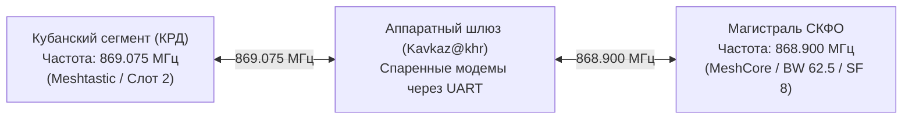

# Архивные частоты, пресеты и канал «Stavropol» в Meshtastic

В период 2024–2025 годов радиолюбительское сообщество Ставрополя и СКФО использовало стандартную для Meshtastic в РФ частотную сетку и типовой радиопрофиль `LongFast`. Ниже задокументированы параметры, использовавшиеся до общерегионального перехода на MeshCore.

---

## 1. Общероссийский Слот 2 (869.075 МГц)

В экосистеме Meshtastic для Российской Федерации диапазон 868 МГц разбит на 3 стандартных частотных слота (при ширине полосы 250 кГц):

| Слот | Центральная частота | Статус в РФ | Назначение в Meshtastic |
| :--- | :--- | :--- | :--- |
| **Слот 1** | **868.825 МГц** | Разрешен (до 25 мВт) | Альтернативный канал |
| **Слот 2** | **869.075 МГц** | Разрешен (до 25 мВт) | **Основной общероссийский канал по умолчанию** |
| **Слот 3** | **869.325 МГц** | Выход за пределы безлицензионного диапазона РФ | Запрещен к использованию в РФ |

Сообщество СКФО на начальном этапе выбрало **Слот 2 (869.075 МГц)** для совместимости с другими регионами России (в частности, с Краснодарским краем и Ростовом-на-Дону).

---

## 2. Стандартный радиопрофиль `LongFast`

В качестве базового профиля модуляции использовался стоковый пресет Meshtastic `LongFast`:

- **Полоса пропускания (Bandwidth):** `250 кГц` (BW 250)
- **Коэффициент расширения спектра (Spreading Factor):** `SF 11`
- **Коэффициент коррекции ошибок (Coding Rate):** `CR 4/5` (CR 5)
- **Скорость передачи данных:** ~1.06 кбит/с

### Причины отказа от пресета LongFast:

1. **Гигантское время занятия эфира (Airtime):**
   При полосе 250 кГц и SF11 передача даже простейшего текстового сообщения занимала **от 600 до 950 миллисекунд**. В условиях более 15–20 нод эфир непрерывно перекрывался встречными пакетами.
2. **Коллизии и пакетные штормы:**
   Из-за лавинообразного алгоритма ретрансляции одновременный выход в эфир 3–4 узлов вызывал 100% коллизию, приводящую к потере сообщений и ложным повторным передачам (Retransmit Storm).
3. **Высокий порог шумов:**
   Широкая полоса (250 кГц) собирает в 4 раза больше теплового и индустриального шума эфира по сравнению с узкой полосой 62.5 кГц, применяемой в MeshCore.

---

## 3. Исторический городской приватный канал «Stavropol»

Для защиты локального эфира Ставрополя от всероссийского флуда и тестовых пакетов новичков на общедоступном канале `LongFast / Public`, сообществом был создан выделенный канал:

- **Имя канала:** `Stavropol`
- **Алгоритм шифрования:** AES-256 (Pre-Shared Key / PSK)
- **Ключ шифрования (Base64):**
  `Bvepap6awYZ07NUBNScH/N9p2vNn7sMDEVlEt7oKQXs=`
- **Происхождение ключа:** Хеш-функция SHA-256 от кодовой фразы `Johnny Mnemonic` (дань культовому киберпанк-произведению).

Канал `Stavropol` объединял домашние узлы радиолюбителей Северо-Западного, Юго-Западного районов, центра Ставрополя и высотный репитер на горе Стрижамент.

---

## 4. Смежные регионы и кросс-бенд шлюзы

В соседнем Краснодарском крае (Кубань) часть пользователей продолжает использовать частоту **869.075 МГц**. 

Для сохранения взаимодействия между регионами сообщество СКФО использует специальные двухмодемные кросс-бенд мосты:

Шлюз транслирует только разрешенные сообщения и аварийные сводки, отсекая локальный внутригородской флуд обеих сторон.
