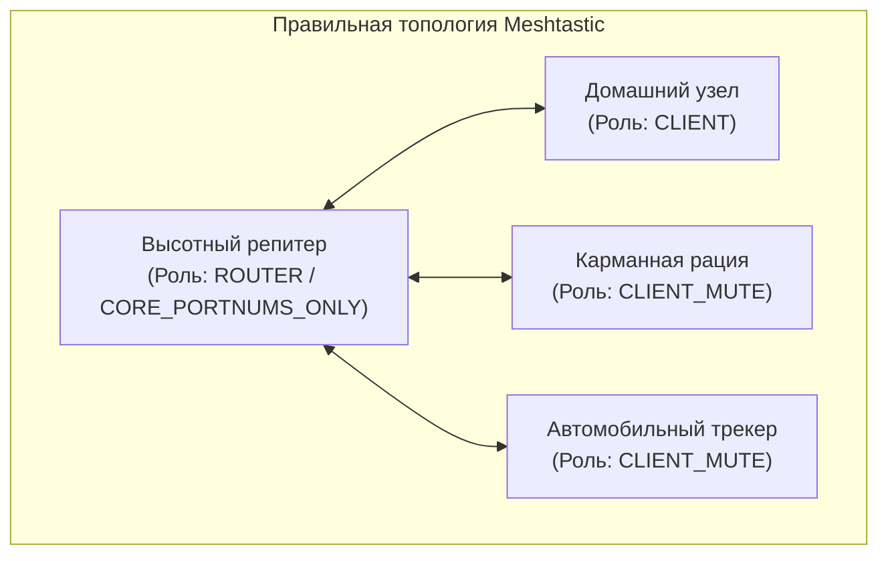

# Настройка узлов Meshtastic: фильтрация портов и роли

В период использования прошивки Meshtastic сообщество СКФО выработало жесткий регламент конфигурирования клиентских устройств и ретрансляторов для борьбы с засорением эфира и бесконтрольным лавинным роутингом.

---

## 1. Фильтрация портов: режим `CORE_PORTNUMS_ONLY`

Главной опасностью для стабильности радиоэфира в Meshtastic является передача тяжелых оверлейных данных сторонними программами (например, постоянный обмен геоданными и маркерами в ATAK, непрерывный телеметрический поток с метеостанций и датчиков).

Чтобы предотвратить коллапс сети, на всех промежуточных репитерах и узлах с ролью `ROUTER` обязательно активировался параметр:

```text
Rebroadcast Mode: CORE_PORTNUMS_ONLY
```

### Разрешенные порты (Core Ports):

- `TEXT_MESSAGE_APP` (Порт 1) — пользовательские текстовые сообщения в публичных и приватных каналах;
- `POSITION_APP` (Порт 3) — координаты местоположения (с жестко ограниченным интервалом отправки не чаще 1 раза в 15–30 минут);
- `NODEINFO_APP` (Порт 4) — базовые идентификационные данные ноды (позывной, имя, аппаратная платформа);
- `ROUTING_APP` (Порт 5) — служебные пакеты согласования маршрутов и подтверждения (ACK).

### Блокируемые протоколы:

Все остальные пакеты (включая неконтролируемый трафик плагинов, тестовые пакеты и тяжелые массивы данных) отбрасываются узлом и не ретранслируются дальше.

---

## 2. Роли устройств в экосистеме Meshtastic

Правильный выбор роли устройства в Meshtastic критически влиял на маршрутизацию всей сети:

| Роль | Назначение | Поведение в радиоэфире |
| :--- | :--- | :--- |
| **`CLIENT_MUTE`** | Карманные рации (EDC), мобильные ноды в машинах | Принимает все пакеты, отправляет свои. **Никогда не ретранслирует чужой трафик.** |
| **`CLIENT`** | Стационарные домашние ноды с хорошей внешней антенной | Принимает и отправляет сообщения, ретранслирует чужие пакеты с уменьшением TTL (hop count). |
| **`ROUTER` / `REPEATER`** | Стационарные высотные ретрансляторы (Стрижамент, Машук) | Имеет приоритет при арбитраже радиоэфира, обслуживает транзитные пакеты между секторами. |



!!! danger "Ошибка «Мобильного роутера»"
    Если пользователь активировал роль `ROUTER` на карманной плате в рюкзаке или автомобиле, перемещаясь по городу в условиях экранирования железобетонными зданиями, нода перехватывала пакеты, объявляла себя лучшим маршрутом и затем теряла сигнал. Это приводило к фрагментации сети и потере сообщений десятков участников.

---

## 3. Базовые команды Meshtastic CLI

Для конфигурирования устройств по USB-кабелю использовалась официальная утилита Python `meshtastic`:

```bash
# Установка утилиты
pip install --upgrade meshtastic

# Просмотр информации об узле
meshtastic --info

# Установка роли CLIENT_MUTE
meshtastic --set device.role CLIENT_MUTE

# Установка режима фильтрации CORE_PORTNUMS_ONLY
meshtastic --set device.rebroadcast_mode CORE_PORTNUMS_ONLY

# Установка лимита хопов (Hop Limit)
meshtastic --set lora.hop_limit 3

# Установка частотного слота (Слот 2 = 869.075 МГц)
meshtastic --set lora.channel_num 2

# Установка выходной мощности (до 14 дБм / 25 мВт по закону РФ)
meshtastic --set lora.tx_power 14
```
