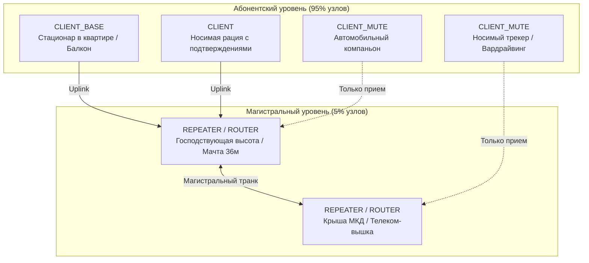

# Конфигурация репитеров и борьба со штормами в сети MeshCore

Устойчивость децентрализованной радиосети LoRa напрямую зависит от дисциплины радиоэфира. При классическом бесконтрольном лавинообразном флуде появление нескольких ретрансляторов с широким охватом приводит к явлению **эхо-шторма** (Echo Storm), взаимным коллизиям и полной деградации сети. В сообществе СКФО выработан строгий регламент распределения ролей узлов и эталонный профиль конфигурации параметров ядра MeshCore.

---

## 1. Роли нод в сети: почему 95% должны быть CLIENT / CLIENT_MUTE

В ячеистых сетях LoRa действует закон: *«Чем меньше узлов ретранслируют пакеты, тем стабильнее работает сеть»*. Полноценный статус ретранслятора разрешено включать исключительно на стационарных узлах, расположенных на господствующих высотах с круговой диаграммой направленности.



### Детальная классификация ролей:

1. **`CLIENT_MUTE` (Рекомендуется для 70% носимых и мобильных устройств):**
    - Узел работает исключительно на прием и собственную передачу.
    - **Категорически запрещено ретранслировать чужие пакеты.**
    - Устройство не занимает эфир подтверждениями маршрутов и не вносит хаос при перемещении в автомобиле или пешком.
2. **`CLIENT` (Обычный клиентский режим для 20–25% участников):**
    - Носимая станция активного пользователя.
    - Отправляет свои сообщения и подтверждения (ACK), но **не ретранслирует** чужой широковещательный трафик.
3. **`CLIENT_BASE` (Домашняя базовая станция / балконный узел):**
    - Стационарный домашний компаньон, обеспечивающий связь внутри квартиры и на прилегающей дворовой территории.
    - За счет узкого сектора обзора из окна не должен работать глобальным роутером, чтобы не экранировать отраженные сигналы и не плодить эхо.
4. **`REPEATER` / `ROUTER` (Не более 5% от всей сети):**
    - Выделенные автономные радиомачты (г. Стрижамент, 204-й квартал, ул. Макарова, г. Машук, плато Бермамыт).
    - Оснащены высококачественными фильтрами, антеннами с согласованным КСВ < 1.15 и автономным питанием LiFePO4 + СБ.

!!! warning
    Включение роли `REPEATER` или `ROUTER` на подоконнике квартиры за стеклопакетом — грубейшая ошибка! Такой узел глушит сам себя переотражениями, собирает помехи от импульсных блоков питания и дробит магистральные пакеты, срывая доставку до реальных абонентов.

---

## 2. Полный эталонный конфиг CLI MeshCore для ретранслятора

Ниже приведен согласованный координаторами сети эталонный набор параметров командной строки (CLI) для магистрального узла ядра СКФО:

```text
# --- Радиочастотный интерфейс ---
set radio 868.900, 62.5, 8, 8   # Частота сети 868.900 МГц, полоса 62.5 кГц, SF8, CR8
set cad on                       # Аппаратная детекция активности канала (Channel Activity Detection)
set radio.rxgain on              # Активация режима Boosted RX на SX1262 (максимальная чувствительность)

# --- Настройка таймингов и борьба с коллизиями ---
set txdelay 2                    # Разброс псевдослучайной задержки ретрансляции флуда
set direct.txdelay 1             # Задержка для Direct-сообщений (ускорение round-trip без коллизий)
set rxdelay 3                    # Арбитраж лучшего пути: узел с лучшим приемом шлет первым, остальные гасят дубль
set agc.reset.interval 8         # Принудительный сброс AGC каждые 8 сек (защита от захвата сильным сигналом near-far)

# --- Маршрутизация и предотвращение штормов ---
set loop.detect strict           # Жесткий контроль петель (обязателен для высоких обзорных точек)
set multi.acks 0                 # Отключение дублирующих подтверждений (строго 1 ACK)
set path.hash.mode 1             # Двухбайтовый режим хеширования пути для исключения коллизий хэшей
set flood.max 12                 # Максимальный лимит хопов для сообщений с валидным Scope
set flood.max.unscoped 3         # Жесткий лимит 3 хопа для сообщений без Scope (локализация спама)

# --- Служебный трафик и маяки ---
set advert.interval 240          # Локальный маяк соседей (Adverts) раз в 240 минут (4 часа)
set flood.advert.interval 23     # Глобальный флуд-маяк имени и геопозиции раз в 23 часа (жесткая экономия эфира)

# --- Мощность передатчика ---
# Для обычных плат (Heltec V3, nRF52, T-Echo):
set tx 11                        # Нормативные 25 мВт
# Для плат с внешним FEM/LNA (Heltec V4, Seeed T096):
# set tx -1
# set radio.fem.rxgain on

# --- Безопасность и администрирование ---
set guest.password 123456        # Пароль для публичного read-only мониторинга статуса
reboot                           # Обязательная перезагрузка для инициализации регистров LoRa
clock sync                       # Синхронизация системных часов узла через 30 сек после ребута
```

---

## 3. Детальный разбор ключевых защитных директив

### 3.1. Аппаратный CAD (`set cad on`)
Перед выходом в эфир трансивер Semtech SX1262 переводится в режим детекции преамбулы LoRa на выбранном SF. Если в эфире уже обнаружен активный сигнал, узел откладывает передачу на случайный джиттер. Это исключает наложение пакетов друг на друга во времени.

### 3.2. Механизм `rxdelay 3` vs `rxdelay 0.7`

- Параметр `rxdelay` определяет окно оценки качества сигнала (Score-арбитраж).
- При получении пакета репитер рассчитывает задержку перед ретрансляцией: чем выше SNR/RSSI (лучше сигнал), тем быстрее узел отправляет пакет.
- Значение **`set rxdelay 3`** является сетевым стандартом для распределенных сетей: узел с наилучшим качеством линка выходит в эфир первым; соседние репитеры слышат ретрансляцию и мгновенно подавляют свой дубль.
- *Дискуссия по `rxdelay 0.7`:* В плотных локальных кластерах (например, внутри одного жилого квартала) снижение до 0.7 с ускоряет отклик, однако на господствующих высотах приводит к рассинхронизации арбитража и порождает эхо-штормы.

### 3.3. Разгрузка эфира (`flood.advert.interval 23h`)
Штатные настройки часто отправляют широковещательные анонсы имени узла каждые 15–30 минут. При 50 нодах в регионе это создает непрерывный паразитный гул. Установка `flood.advert.interval 23` (раз в 23 часа) практически полностью освобождает радиоэфир для реальных пользовательских сообщений.

### 3.4. Защита приемника (`agc.reset.interval 8`)
Эффект «Near-Far»: если мимо репитера проезжает автомобиль с передатчиком максимальной мощности, автоматическая регулировка усиления (АРУ / AGC) трансивера загрубляет входной тракт, и репитер на несколько минут «слепнет» к дальним слабым сигналам. Сброс AGC каждые 8 секунд принудительно возвращает тракт в максимальную чувствительность.

---

## 4. Фильтрация портов в Meshtastic: `CORE_PORTNUMS_ONLY`

Для сегментов сети, где сохраняется эксплуатация оборудования на прошивке Meshtastic, критически важно активировать фильтрацию трафика по портам:

```text
Rebroadcast Mode: CORE_PORTNUMS_ONLY
```

### Зачем это необходимо:

- **Разрешенные порты:**
    - `TEXT_MESSAGE_APP` (Порт 1) — текстовые чаты;
    - `POSITION_APP` (Порт 3) — геопозиция узлов;
    - `NODEINFO_APP` (Порт 4) — информация об узле (имя, позывной);
    - `ROUTING_APP` (Порт 5) — служебный обмен маршрутами.
- **Блокируемые протоколы:**
    - Блокирует тяжелые оверлеи внешних программ, например, непрерывные тактические пакеты **ATAK (CivTAK / WinTAK)**, потоковые телеметрические логи сенсоров окружающей среды и паразитные широковещательные запросы плагинов.
    - Предотвращает паралич общедоступного канала сторонним софтом.
