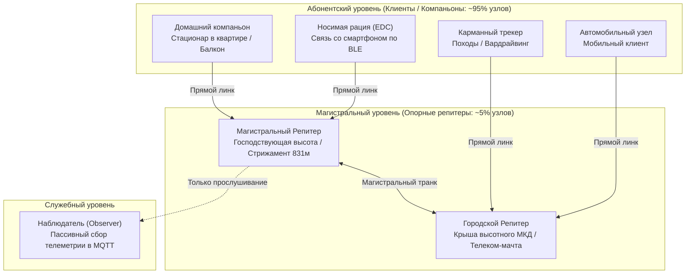

# Конфигурация репитеров и борьба со штормами в сети MeshCore

Устойчивость децентрализованной радиосети LoRa напрямую зависит от дисциплины радиоэфира. При классическом бесконтрольном лавинообразном флуде появление нескольких ретрансляторов с широким охватом приводит к явлению **эхо-шторма** (Echo Storm), взаимным коллизиям и полной деградации сети. В сообществе СКФО выработан строгий регламент распределения ролей узлов и эталонный профиль конфигурации параметров ядра MeshCore.

---

## 1. Архитектура сети MeshCore: разделение на Клиенты и Репитеры

В ячеистых сетях LoRa действует незыблемый закон радиоэфира: *«Чем меньше узлов ретранслируют пакеты, тем стабильнее и быстрее работает сеть»*. 

В отличие от устаревшего протокола Meshtastic, где все узлы по умолчанию пытались ретранслировать каждый услышанный пакет во все стороны (лавинный флуд), в **MeshCore** применяется направленная маршрутизация (**Directed Routing**), а устройства четко разделены по назначению:



### Детальная классификация узлов:

1. **Абонентские клиенты (Client / Companion — 95% узлов сети):**
    - Карманные рации (EDC), носимые трекеры, домашние прикроватные или балконные станции.
    - Узлы принимают и отправляют личный трафик пользователя, а также запрашивают пропущенные сообщения с RoomServer.
    - **Клиентские узлы не ретранслируют чужой транзитный трафик**, благодаря чему сеть не испытывает паразитной нагрузки при перемещении пользователей по городу.
2. **Опорные ретрансляторы (Repeater / Router — не более 5% сети):**
    - Выделенные автономные радиомачты на господствующих вершинах (г. Стрижамент, гора Бештау, Машук, высотные здания Ставрополя).
    - Оснащены качественными полосовыми фильтрами, антеннами с согласованным КСВ < 1.15 и автономным питанием LiFePO4 + солнечные батареи.
    - Выполняют направленную ретрансляцию с арбитражем задержек (`rxdelay`) и фильтрацией гео-зон (`denyf *`).
3. **Наблюдатели (Observer):**
    - Узлы пассивного радиомониторинга (прошивка VBart Observer). Они непрерывно слушают эфир, фиксируют уровень сигнала (RSSI/SNR) и передают телеметрию на серверы мониторинга [skmesh.ru](https://skmesh.ru), ничего не излучая обратно в радиоканал.

!!! warning "Ошибка установки репитера дома"
    Развертывание узла в режиме ретранслятора (Repeater) на подоконнике квартиры за стеклопакетом — грубейшая ошибка! Такой узел глушит сам себя переотражениями от железобетона, собирает индустриальные помехи от импульсных блоков питания и дробит магистральные пакеты, срывая доставку до реальных абонентов. Режим репитера допустим только на внешних высотных позициях с открытым горизонтом.

---

## 2. Полный эталонный конфиг CLI MeshCore для ретранслятора

Ниже приведен согласованный координаторами сети эталонный набор параметров командной строки (CLI) для магистрального узла ядра СКФО:

```text
# --- Радиочастотный интерфейс ---
set radio 868.900, 62.5, 8, 8   # Частота сети 868.900 МГц, полоса 62.5 кГц, SF8, CR8
set cad on                       # Аппаратная детекция активности канала (Channel Activity Detection)
set radio.rxgain on              # Активация режима Boosted RX на SX1262 (максимальная чувствительность)

# --- Настройка таймингов и борьба с коллизиями ---
set txdelay 2                    # Разброс псевдослучайной задержки ретрансляции флуда (окно ~до 10×airtime)
set direct.txdelay 0.5           # Задержка для Direct-сообщений: меньше разброс → быстрее round-trip, но хватает против коллизий
set rxdelay 3                    # Арбитраж лучшего пути (Score-арбитраж): узел с лучшим линком шлет первым, остальные гасят дубль
set agc.reset.interval 8         # Принудительный сброс AGC каждые 8 сек (защита от захвата сильным сигналом near-far)

# --- Маршрутизация и предотвращение штормов ---
set loop.detect strict           # Жесткий контроль петель (обязателен для высоких обзорных точек)
set multi.acks 0                 # Отключение дублирующих подтверждений (строго 1 ACK)
set path.hash.mode 1             # Двухбайтовый режим хеширования пути для исключения коллизий хэшей
set flood.max 12                 # Максимальный лимит хопов для сообщений с валидным Scope
set flood.max.unscoped 3         # Жесткий лимит 3 хопа для сообщений без Scope (локализация спама)

# --- Служебный трафик и маяки ---
set advert.interval 240          # Локальный маяк соседей (Adverts) раз в 240 минут (4 часа)
set flood.advert.interval 23     # Глобальный флуд-маяк имени и геопозиции раз в 23 часа (жесткая экономия эфира)

# --- Мощность передатчика ---
# Для обычных плат (Heltec V3, nRF52, T-Echo):
set tx 11                        # Нормативные 25 мВт
# Для плат с внешним FEM/LNA (Heltec V4, Seeed T096):
# set tx -1
# set radio.fem.rxgain on

# --- Безопасность и администрирование ---
set guest.password 123456        # Пароль для публичного read-only мониторинга статуса
reboot                           # Обязательная перезагрузка для инициализации регистров LoRa
clock sync                       # Синхронизация системных часов узла через 30 сек после ребута
```

---

## 3. Детальный разбор ключевых защитных директив

### 3.1. Аппаратный CAD (`set cad on`)
Перед выходом в эфир трансивер Semtech SX1262 переводится в режим детекции преамбулы LoRa на выбранном SF. Если в эфире уже обнаружен активный сигнал, узел откладывает передачу на случайный джиттер. Это исключает наложение пакетов друг на друга во времени.

### 3.2. Механизм `rxdelay 3` и арбитраж лучшего пути

- Параметр `rxdelay` определяет окно оценки качества сигнала (Score-арбитраж) и принимает базовое целочисленное значение (0 — выключен, диапазон 1–6).
- При получении пакета репитер рассчитывает задержку перед ретрансляцией: чем выше SNR/RSSI (лучше сигнал), тем быстрее узел отправляет пакет.
- Значение **`set rxdelay 3`** является утвержденным сетевым стандартом СКФО: узел с наилучшим качеством линка выходит в эфир первым; соседние репитеры слышат ретрансляцию и мгновенно подавляют свой дубль.
- *Примечание о дискуссиях в сообществе:* Возникавшие в чате споры о «задержке 0.7 с» были вызваны ошибочным пониманием параметра как временной паузы приемника. В синтаксисе ядра MeshCore `rxdelay` оперирует целочисленным весовым коэффициентом арбитража, где 0 отключает подавление дублей (вызывая коллизии), а значения 2–4 обеспечивают идеальный баланс скорости и чистоты эфира.

### 3.3. Разгрузка эфира (`flood.advert.interval 23h`)
Штатные настройки часто отправляют широковещательные анонсы имени узла каждые 15–30 минут. При 50 нодах в регионе это создает непрерывный паразитный гул. Установка `flood.advert.interval 23` (раз в 23 часа) практически полностью освобождает радиоэфир для реальных пользовательских сообщений.

### 3.4. Защита приемника (`agc.reset.interval 8`)
Эффект «Near-Far»: если мимо репитера проезжает автомобиль с передатчиком максимальной мощности, автоматическая регулировка усиления (АРУ / AGC) трансивера загрубляет входной тракт, и репитер на несколько минут «слепнет» к дальним слабым сигналам. Сброс AGC каждые 8 секунд принудительно возвращает тракт в максимальную чувствительность.

---

!!! note "Конфигурация узлов Meshtastic и фильтрация портов"
    Правила настройки оборудования на стоковой прошивке Meshtastic (включая фильтрацию `CORE_PORTNUMS_ONLY` для подавления паразитного флуда ATAK/сенсоров) вынесены в специальный раздел [Настройка узлов Meshtastic](../meshtastic/repeater-and-node-config.md).
