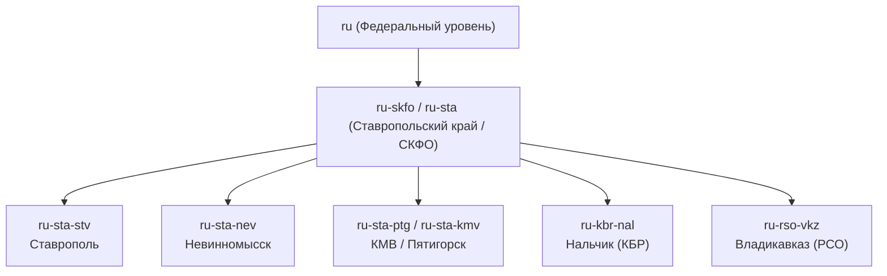
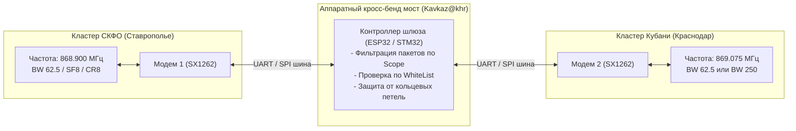

# Маршрутизация, гео-зоны (Scopes) и мосты в сети СКФО

По мере территориального разрастания сети от Ставрополя до Невинномысска, Кавказских Минеральных Вод, Карачаево-Черкесии, Кабардино-Балкарии и Северной Осетии критической задачей стала изоляция локального трафика городов от транзитных магистралей. Архитектура **Scopes (Областей видимости)** и аппаратных мостов решает эту задачу на канальном и сетевом уровнях.

---

## 1. Концепция Scopes по стандарту ISO 3166-2

В MeshCore внедрена иерархическая система тегирования трафика — **Scopes**. Пакет помечается идентификатором региона назначения или происхождения.



### Принятые в регионе префиксы:

- `ru` — общероссийский глобальный скоуп (только экстренные сообщения и анонсы ядра);
- `ru-skfo` / `ru-sta` — общекраевой / окружной скоуп (трафик между городами региона);
- `ru-sta-stv` — город Ставрополь (включая пригород: Михайловск, Демино);
- `ru-sta-nev` — город Невинномысск и Кочубеевский район;
- `ru-sta-ptg` / `ru-sta-kmv` — Кавказские Минеральные Воды (Пятигорск, Кисловодск, Ессентуки, Железноводск);
- `ru-kbr-nal` — Нальчик (Кабардино-Балкарская Республика);
- `ru-rso-vkz` — Владикавказ (Республика Северная Осетия — Алания).

---

## 2. Фильтрация флуда на репитерах: директива `denyf *`

Главная беда неструктурированных сетей — бытовой флуд в городском чате, который транслируется высотными репитерами за сотни километров, забивая эфир соседних городов.

Для предотвращения этой проблемы на высотных магистральных ретрансляторах введена жесткая политика правил пересылки:

```text
# Пример настройки правил фильтрации флуда на ретрансляторе:
set denyf *                 # Запретить ретрансляцию безадресного трафика без явного scope
set allowf ru-skfo          # Разрешить транзит региональных сообщений СКФО
set allowf ru-sta           # Разрешить транзит краевых сообщений
set allowf ru-sta-stv       # Разрешить сообщения для Ставрополя
set flood.max.unscoped 3    # Ограничить пакеты без scope максимум 3 хопами внутри жилого массива
set flood.max 12            # Сообщения со scope могут проходить до 12 хопов через магистраль
```

### Как это работает на практике:

1. Обычное сообщение пользователя в домашнем локальном чате без указания скоупа имеет лимит `flood.max.unscoped 3`. Оно обойдет соседние дома, но высотный репитер с правилом `denyf *` откажется транслировать его на весь край.
2. Если пользователь хочет связаться с Невинномысском или передать сводку на весь край, он выбирает канал со скоупом `ru-skfo` или адресно `ru-sta-nev`. Высотный узел видит разрешенный префикс, пропускает пакет и передает его по магистральной цепочке.

---

## 3. Кросс-бенд и кросс-частотные шлюзы (868.900 <-> 869.075 МГц)

Краснодарский край и часть смежных сетей работают на частоте **869.075 МГц**, тогда как ядро СКФО стандартизировано на **868.900 МГц**. Чтобы связать оба кластера без взаимных радиопомех, созданы двухмодемные аппаратные шлюзы.



### Особенности развертывания кросс-частотных шлюзов:

- **Разнос антенн:** Физическое расстояние между антеннами 868.900 и 869.075 МГц должно составлять не менее 1.5–2 метров по вертикали (или использование узкополосных спиральных резонаторных фильтров/дуплексеров), чтобы передатчик одного модема не блокировал приемник другого.
- **Интеллектуальная трансляция:** Шлюз не передает подряд все сырые пакеты. Через границу регионов пропускаются только:
    - Адресные личные сообщения (Direct Messages);
    - Телеметрия узлов с флагом межрегионального обмена;
    - Пакеты скоупов `ru` и `ru-skfo`.

---

## 4. Криптографические белые списки (Whitelists)

В периоды активного засорения эфира посторонними устройствами (неправильно настроенные погодные датчики, циклический спам ботов, хулиганские генераторы шума) магистральные узлы переводятся в режим доверенной авторизации:

### Принцип работы WhiteList:

1. Каждый узел в сети обладает уникальной криптографической парой ключей (Ed25519 / Curve25519).
2. На магистральных репитерах формируется список доверенных публичных ключей (`Public Keys` проверенных участников сообщества и инфраструктурных репитеров).
3. При поступлении пакета ретранслятор проверяет цифровую подпись:
    - Если открытый ключ узла присутствует в списке `whitelist` — пакет немедленно ставится в очередь на трансляцию.
    - Если ключ отсутствует — узел отбрасывает пакет без выхода в эфир.
4. Данная архитектура позволяет строить защищенную «выделенную магистраль» между городами, полностью изолированную от хаоса в неконтролируемом пользовательском эфире.
