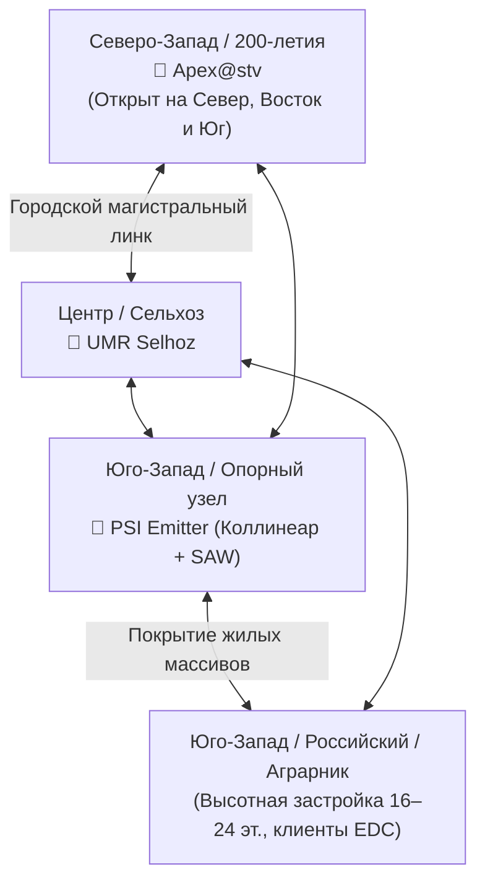

# Городские кластеры и локации (City Clusters)

Сеть Meshcore СКФО состоит из нескольких крупных городских и агломерационных кластеров, связанных между собой магистральными высотными ретрансляторами. Каждый кластер обладает уникальными географическими условиями, застройкой и профилем радиопрохождения.

---

## 1. Кластер «Ставрополь»

Ставрополь расположен на холмистом плато Ставропольской возвышенности с перепадами абсолютных высот от **606 до 750 метров** над уровнем моря. Этот перепад создает как преимущества (возможность накрыть обширные территории с высоток Юго-Западного и Северо-Западного районов), так и выраженные радиотени в низинах (Ташла, Чапаевка, русла малых рек).

### Ключевые опорные узлы города:

- **`Apex@stv` (Северо-Запад / район 200-летия):**
    - Референсный узел Ставрополя, расположенный на северном склоне возвышенности.
    - Обладает открытым горизонтом на север и восток (в сторону Изобильного, Михайловска, Арзгира) и дальним выходом на южное направление. Именно этот узел стал автором абсолютного рекорда прямой радиосвязи с Владикавказом.
- **`PSI Emitter` (Юго-Западный район):**
    - Центральный высотный узел Ставрополя на базе специализированной коллинеарной антенны с повышенным усилением ("Psi Emitter", расчетная разработка участников сообщества).
    - Оснащен радиочастотным SAW-полосовым фильтром на 868 МГц, защищающим приемник SX1262 от близлежащих секторов базовых станций GSM-900 / LTE-800 и коммерческих ретрансляторов.
    - Обеспечивает стабильный прием слабых сигналов от носимых карманных клиентов (раций и трекеров) из дворовых колодцев и цокольных этажей.
- **`UMR Selhoz` (Центральный район / пер. Зоотехнический):**
    - Размещен на высотном здании студенческого городка / Сельхозинститута.
    - Закрывает исторический центр города и образует надежный треугольник взаимного резервирования с узлами `Apex` и `PSI Emitter`.
- **Районы «Российский», «Перспективный», «Аграрник»:**
    - Характеризуются плотной многоэтажной монолитно-железобетонной застройкой (18–24 этажа).
    - Внутри дворов прямая видимость отсутствует; связь обеспечивается множественными переотражениями от фасадов и окон, либо прямым приемом нод, установленных на верхних технических этажах.

---

## 2. Кластер «Невинномысск»

Город Невинномысск расположен в глубокой долине слияния рек Большой Зеленчук и Кубань на высотах около 300–340 м над уровнем моря. Город отделен от Ставрополя мощным массивом горы Стрижамент и Недреманного хребта.

### Опорные узлы и особенности:

- **Узел «Палка»:**
    - Размещен на мачте/возвышенности с 550-мм фиберглассовой коллинеарной антенной.
    - Выполняет функцию ключевого магистрального моста, связывающего инфраструктуру долины Невинномысска со Стрижаментом и вершиной горы Бештау.
- **Автономный репитер `RepN` (Район Головное):**
    - Полностью необслуживаемый узел в герметичном исполнении.
    - Оснащен J-образной антенной из медной трубки/проволоки (отличный заземленный грозозащитный контур), аккумулятором повышенной емкости (LiFePO4) и солнечной панелью 10 Вт.
    - Обеспечивает устойчивый радиоканал через горный хребет до Стрижамента, передавая трафик невинномысцев в Ставрополь без задержек.

---

## 3. Кластер «КМВ» (Кавказские Минеральные Воды)

Агломерация КМВ представляет собой сеть городов, окруженных горами-лакколитами:

- **Пятигорск:** Окружен горами Машук, Бештау и Дубровка. Городской рельеф амфитеатром спускается к реке Подкумок. Ноды на южных склонах Машука надежно закрывают городскую чашу.
- **Кисловодск:** Расположен в глубокой горной котловине (высоты 800–1000 м). Прямая радиовидимость равнинного Ставрополья отсюда невозможна; связь осуществляется исключительно через высотные ретрансляторы Бештау или промежуточные ноды в Ессентуках.
- **Ессентуки и Железноводск:** Занимают равнинно-предгорные участки между Машуком и Бештау. Служат естественными промежуточными звеньями для распространения радиоволн вдоль транспортного коридора трассы Минводы — Кисловодск.

---

## 4. Особенности распространения сигнала в складках горного рельефа и застройке

| Фактор среды | Влияние на радиоканал LoRa 868 МГц | Решение сообщества Meshcore СКФО |
| :--- | :--- | :--- |
| **Складки горного рельефа** | Глубокая дифракционная тень за хребтами. Затухание более 40–50 дБ при закрытии зоны Френеля более чем на 60%. | Установка узлов на естественных доминантах (Стрижамент, лакколиты) и использование пассивных переотражений от противоположных склонов ущелий. |
| **Железобетонная застройка** | Арматурная сетка работает как клетка Фарадея. Монолитные стены вносят затухание до 20–30 дБ на капитальную стену. | Вынос антенн на балконы и крыши; использование оконных репитеров на верхних этажах для засветки дворовых территорий. |
| **Современные стеклопакеты** | Окна с энергосберегающим i-напылением (оксиды металлов) экранируют ВЧ-сигнал на 15–25 дБ, превращая комнатную ноду в «глухую». | Монтаж антенны за пределами оконного проема на внешнем кронштейне с качественным пигтейлом. |
| **Индустриальный шум и БС сотовой связи** | Плотная сетка базовых станций GSM-900 / LTE-800 в городах вызывает забитие (десенситизацию) дешевых приемников SX1262. | Установка SAW-фильтров на 868 МГц с крутыми фронтами перед антенным входом радиомодема. |
