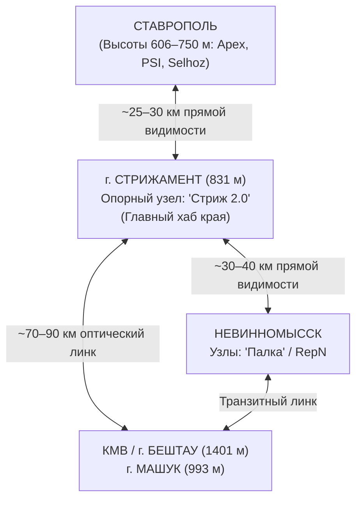
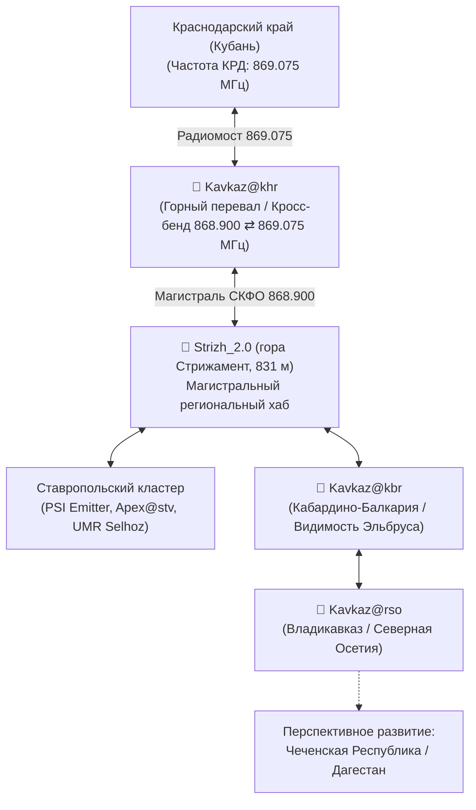

# Магистральная сеть и высоты СКФО (Regional Backbone)

Магистральная сеть Meshcore Северо-Кавказского федерального округа (СКФО) построена на принципах использования естественных орографических доминант региона. Благодаря сочетанию степных равнин Ставропольской возвышенности и вулканических гор-лакколитов региона Кавказских Минеральных Вод (КМВ) с отрогами Главного Кавказского хребта, радиосеть формирует надежную межрегиональную инфраструктуру на сотни километров без использования проводного интернета.

---

## 1. Гора Стрижамент (831 м) — Стратегический узел связи («Стриж 2.0»)

Гора Стрижамент — высшая точка Ставропольской возвышенности (831 метр над уровнем моря) и ключевой географический хаб всего Ставропольского края.

### Значение узла «Стриж 2.0»

* **Мост «Ставрополь — Невинномысск»:** Стрижамент физически закрывает прямую радиовидимость между низинами Невинномысска (долина реки Кубань, ~320 м) и Ставрополем. Размещение ретранслятора `Strizh_2.0` на вершине позволило замкнуть эти два крупнейших промышленных кластера в единую бесподстроечную транспортную сеть.
* **Транзитный перекресток:** Помимо связки Ставрополь — Невинномысск, с высоты 831 м открывается прямая радиовидимость на трассу Р-217 «Кавказ» (район поста М29), западные районы края, а также дальние лучи в сторону Кубани и КМВ.
* **Автономность и климат:** Узел спроектирован с учетом экстремальных ветровых нагрузок Ставропольской возвышенности (порывы ветра до 30–35 м/с, гололедные явления). Антенно-мачтовые конструкции укреплены тросовыми оттяжками с винтовыми талрепами, а электропитание базируется на низкотемпературных аккумуляторах с защитой от глубокого разряда и буферных солнечных панелях.

> [!IMPORTANT]
> Если узел на горе Стрижамент уходит в оффлайн (например, при затяжной зимней непогоде без солнечной генерации), магистральная межгородская сеть фрагментируется на изолированные городские кластеры.

---

## 2. Кавказский хребет и ключевые высоты

Рельеф СКФО представлен резким контрастом между равнинами и горными массивами. Использование островных гор-лакколитов позволяет развертывать ретрансляторы с гигантской зоной видимости.

### Гора Бештау (1401 м, Пятигорье)

* **Роль:** Главная доминанта региона Кавказских Минеральных Вод (КМВ). Вершина изолирована от основного Кавказского хребта и имеет круговой обзор 360° на десятки и сотни километров.
* **Зона покрытия:** Обеспечивает сплошное ковровое покрытие Пятигорска, Железноводска, Ессентуков, Минеральных Вод, Лермонтова и связывает их с магистралью Ставрополя.
* **Эфирная обстановка и специфика:** Вершина Бештау перегружена ведомственными, коммерческими и связными радиопередатчиками большой мощности. Установка LoRa-нод на Бештау требует:
    - Обязательного применения полосовых SAW-фильтров (868 МГц) с крутыми скатами АЧХ;
    - Тщательного экранирования управляющей электроники;
    - Применения качественных линейных или глубоко фильтрованных импульсных стабилизаторов напряжения.

### Гора Машук (993 м)

* Расположена непосредственно над Пятигорском. Служит вспомогательным высотным узлом для плотной городской застройки КМВ.
* Из-за непосредственного соседства с Пятигорской телевышкой и радиовещательными передатчиками уровень внеполосных индустриальных помех здесь максимален. Модемы LoRa без внешних фильтров испытывают блокировку приемного тракта (десенситизацию).

### Гора Змейка (994 м)

* Господствующая высота над Минеральными Водами и аэропортом. Обеспечивает покрытие транспортных развязок, железнодорожного узла и восточного сектора КМВ, закрытого от Бештау складками рельефа.

### Высотные ретрансляторы КБР (Кабардино-Балкария)

* Узлы, развернутые в предгорьях и ущельях КБР, имеют прямую оптическую видимость массива горы Эльбрус (5642 м).
* Обеспечивают радиопокрытие туристических маршрутов в районе Джилы-Су с высот от 2500–3000 м, замыкая высокогорные альпинистские стоянки на равнинную инфраструктуру.

### РСО-Алания (Владикавказ)

* Высотные точки на хребтах вокруг Владикавказской котловины обеспечивают прием сигнала со стороны равнинной части Ставрополья и формируют южный форпост сети Meshcore на Северном Кавказе.

---

## 3. Транзитные магистрали региона

Для обеспечения стабильного межрегионального обмена между краевыми и республиканскими сетями развернута опорная магистральная цепь нод серии `Kavkaz`:

| Идентификатор узла | Локация и специфика | Назначение в магистрали |
| :--- | :--- | :--- |
| **`Kavkaz@khr`** | Граница Ставропольского и Краснодарского краев (горный перевал/высота) | Сквозной транзитный мост между сетями СКФО (Ставрополье) и Кубани (Краснодар). Оснащен кросс-бенд шлюзом 868.900 МГц / 869.075 МГц. |
| **`Kavkaz@kbr`** | Высокогорная позиция в Кабардино-Балкарии (сектор Эльбруса) | Прямой радиомост между центральным Ставропольем, Пятигорьем и высокогорьем КБР. Видимость более 50 узлов сети одновременно. |
| **`Kavkaz@rso`** | Господствующая высота над Владикавказом (Северная Осетия) | Южный терминатор опорного хребта СКФО. Фиксирует дальние пролеты со Ставропольской возвышенности (дистанция 336 км). |

### Структура межрегиональных переходов

### Архитектурные правила магистральных транзитов

1. **Жесткая фильтрация трафика:** Магистральные репитеры серии `Kavkaz` и `Strizh_2.0` используют белые списки публичных ключей (`public key`) или повышенные пороги задержки ретрансляции (`txdelay`), чтобы локальный городской флуд не парализовал дальние радиолинки.
2. **Параметры модуляции LoRa:** Все магистральные узлы работают на стандарте **868.900 МГц, BW 62.5 кГц, SF8, CR 4/8**, обеспечивающем предельный бюджет радиолинии (Link Budget до -138...-140 дБм) при достаточной скорости для текстового и телеметрического протоколов.
